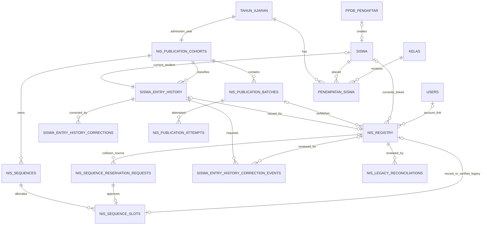
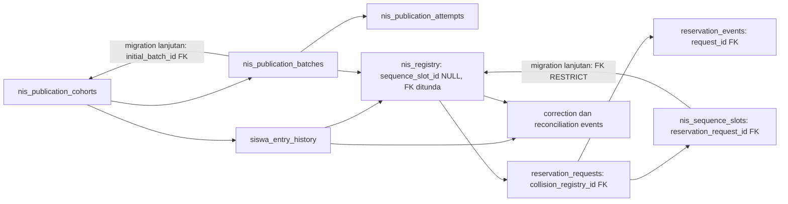

# TAHAP 2A.3 — FINAL TECHNICAL CONSISTENCY REVIEW DESAIN NIS SINERGI-MJ

**Status:** Desain untuk validasi akhir; refinement 2A.3; belum disetujui untuk implementasi  
**Jenis pekerjaan:** Desain dokumentasi saja. Refinement ini hanya memperbarui dokumen desain; tidak ada source, migration, konfigurasi, database, atau Git yang diubah.

## 1. Executive summary

Desain ini memusatkan penerbitan NIS pada satu otoritas domain dan satu ledger permanen. NIS baru diterbitkan setelah entry resmi tercatat dan placement yang sah tersedia. NIS lama tetap persis seperti tersimpan; tidak dinormalisasi, ditebak asal cohort-nya, atau diterbitkan ulang.

Arsitektur yang diusulkan terdiri dari cohort lock per `year_code`, immutable entry history beserta koreksi append-only, allocator sequence `(year_code, entry_grade)`, batch publication, registry NIS permanen, dan log rekonsiliasi/percobaan publish. Semua operasi yang mengubah eligibility, entry history, placement, atau nama calon yang belum diterbitkan menggunakan protokol cohort lock yang sama. Publish menghitung ulang snapshot, melakukan hardblock untuk placement/anomali, lalu menulis seluruh NIS dan sinkronisasi username dalam satu transaksi atomik.

**Belum siap untuk coding.** Blocker utama adalah sorting locale Indonesia: Collator ICU lokal yang diuji melaporkan actual locale `root`; eksperimen Windows NLS belum membuktikan konsistensi PHP dan deployment. Driver, versi database dan runtime deployment juga harus diverifikasi. Urutan supplemental direkomendasikan kronologis dengan tie-break nama/ID, tetapi tetap memerlukan persetujuan owner.

### Klasifikasi informasi

- **FAKTA SOURCE** — terlihat pada source/migration yang dirujuk; bukan bukti runtime.
- **FAKTA AUDIT SEBELUMNYA** — hasil audit Tahap 1/1B/1C yang telah dilakukan, bukan pemeriksaan ulang database saat dokumen ini dibuat.
- **USULAN DESAIN** — mekanisme yang diajukan untuk ditinjau, belum diimplementasikan.
- **INFERENSI** — dampak teknis yang disimpulkan dari fakta.
- **OPEN DECISION** — keputusan yang belum mempunyai dasar kebijakan atau bukti runtime cukup.

## 2. Kebijakan final dan invariant

### Invariant identitas

1. NIS adalah identitas sekolah yang permanen; berbeda dari NISN dan primary key database.
2. Format penerbitan baru `TTTT.T.NNN`; `TTTT` adalah kode empat digit tahun ajaran pertama masuk (bukan otomatis tahun kalender), `T` tingkat pertama masuk, dan `NNN` sequence minimal tiga digit tanpa batas maksimum tiga digit. Contoh yang telah disepakati: tahun ajaran `2026/2027` direpresentasikan sebagai `year_code=2627`; kode tahun kalender `2026` tidak boleh dipakai untuk cohort ini.
3. Tahun dan tingkat entry tidak disimpulkan dari kelas aktif, `angkatan_id`, tahun penerbitan, atau sekolah asal.
4. NIS yang telah diterbitkan tidak dapat diubah, dihapus dari ledger, atau diterbitkan kembali. Perubahan nama tidak mengubah NIS.
5. Semua kelas paralel pada kombinasi `(year_code, entry_grade)` berbagi sequence; rombel tidak membentuk sequence sendiri.
6. Siswa pindahan memakai tingkat pertama masuk yang disahkan, bukan default kelas I.
7. NIS baru hanya diterbitkan setelah entry resmi dan placement pada rombel sah tersedia.
8. Preview tidak mengonsumsi sequence. Publish yang gagal tidak meninggalkan penerbitan parsial.

### Batas initial dan supplemental

- Initial batch adalah satu batch per cohort `year_code`, mencakup semua siswa yang telah resmi menjadi wajib ditempatkan sebelum initial publish, tanpa membedakan PPDB, transfer, atau jalur administratif dan tanpa memisahkan batch menurut tingkat/rombel.
- Transfer yang resmi masuk sebelum initial publish termasuk initial batch. Seluruh tingkat masuk masuk satu batch, tetapi sequence tetap dialokasikan terpisah per `(year_code, entry_grade)`.
- Siswa yang baru resmi masuk sesudah initial publish menjadi calon supplemental, dengan sequence selanjutnya pada grup tingkat masuknya.
- Jalur administrasi bukan penentu tunggal jenis batch. Batas waktu resmi entry terhadap waktu publish awal yang menentukan.
- Supplemental tidak mengubah NIS yang sudah terbit. Temuan siswa pra-publish yang hilang dari initial batch adalah anomali dan memblokir supplemental sampai direkonsiliasi.

### Eligibility dan hardblock

**FAKTA kebijakan:** PPDB normal yang wajib ditempatkan memiliki keputusan diterima final, daftar ulang selesai, `siswa_id` valid, dan record Siswa. Entry resmi dari transfer/manual perlu disahkan melalui workflow administratif yang ekuivalen. Status atau relasi bertentangan merupakan anomali.

**USULAN DESAIN:** Entry history menjadi rekaman resmi keanggotaan cohort; resolver memvalidasi eligibility dari sumber workflow dan mencocokkannya dengan history, Siswa, serta placement. Publish gagal seluruhnya jika ada kandidat wajib ditempatkan yang belum memiliki placement sah, ada relasi/status yang bertentangan, atau ada history/cohort yang tidak dapat divalidasi.

## 3. Arsitektur komponen

### Komponen dan batas otoritas

1. **Admission/cohort eligibility resolver** — menyusun daftar anggota dan alasan eligibility dari keputusan resmi, entry history, Siswa, serta placement. Tidak menerbitkan NIS.
2. **Cohort lock coordinator** — memastikan baris lock ada secara race-safe, mengunci cohort dan record terkait dengan urutan global konsisten, serta meningkatkan revision saat data yang memengaruhi snapshot berubah.
3. **Entry history service** — mencatat entry pertama dalam transaksi setelah lock cohort didapat; menolak duplikasi dan menulis koreksi hanya melalui mekanisme terotorisasi.
4. **Placement/admission mutation services** — otoritas semua perubahan yang berdampak pada membership atau hardblock. Controller, importer, command, job dan rollover memanggil service, bukan menulis tabel langsung.
5. **Name comparator** — menghasilkan urutan deterministik dengan algoritma/runtime/version yang tercatat. Publish fail closed apabila comparator yang disetujui tidak tersedia.
6. **Sequence allocator** — satu-satunya penerbit slot issued; dijalankan dalam transaksi publish. Reservation service hanya dapat membuat slot reserved setelah approval, dengan cohort/sequence lock dan ledger yang sama.
7. **NIS publication service** — **satu-satunya otoritas penerbitan NIS baru**. Membuat/mengubah lifecycle batch, meminta comparator dan allocator, mengisi registry serta `siswa.nis`, dan mengatur username secara atomik.
8. **Legacy reconciliation service** — memasukkan NIS lama apa adanya dan mencatat status/bukti rekonsiliasi. Tidak menerbitkan ulang atau mengubah string legacy.
9. **Database constraints dan trigger (pertahanan tambahan)** — menegakkan uniqueness dan proteksi immutable pada engine yang telah diverifikasi. Tidak menggantikan service atau protokol lock.

### Batas lapisan

- **Controller/view:** validasi request, otorisasi aktor, memanggil service dan menyampaikan hasil/error. Tidak menyusun sequence atau melakukan write langsung ke tabel ledger.
- **Service:** menerapkan transaksi, resolver, cohort lock, validasi hardblock, audit aktor, retry terbatas, dan pemanggilan repository.
- **Model:** relasi/casts/query conveniences. Model guard/event saja bukan jaminan immutability; query builder, raw SQL, import, dan proses lain dapat melewatinya.
- **Database:** unique/FK/check constraints dan trigger yang didukung target menjadi lapisan terakhir. Akses SQL langsung oleh DBA/admin tetap memerlukan kontrol operasional, hak akses dan audit.

### ERD (usulan)



`SISWA`, `USERS`, `PPDB_PENDAFTAR`, `PENEMPATAN_SISWA`, `KELAS`, dan `TAHUN_AJARAN` adalah entitas source existing. Tabel ledger/operasional NIS pada diagram adalah usulan baru; relasi diagram tidak mengklaim bahwa schema aktif sama dengan migration.

## 4. Kamus data seluruh tabel baru/perubahan tabel lama

Semua tipe di bawah adalah **tipe logis yang diusulkan**. Tipe fisik, panjang, collation, `CHECK`, generated/partial index dan syntax perlu disesuaikan setelah driver deployment dipastikan. `created_at`/`updated_at` hanya digunakan bila tabel memang mutable; tabel append-only tidak menyediakan operasi update/delete biasa.

### 4.1 `nis_publication_cohorts`

Satu record menjadi mutex yang stabil untuk semua operasi admission/publish dalam `year_code`. Baris ini dibuat saat pertama kali cohort dipakai, tidak dihapus ketika tahun ajaran ditutup.

| Kolom | Tipe / nullability | Catatan |
|---|---|---|
| `id` | BIGINT PK | ID internal. |
| `tahun_ajaran_id` | BIGINT NOT NULL FK → `tahun_ajaran.id` | Anchor ke record admission-period resmi yang dipakai membentuk cohort; `ON DELETE RESTRICT`. Record ini tidak boleh dipilih berdasarkan tahun kalender aktif tanpa aturan mapping. |
| `year_code` | CHAR(4) NOT NULL UNIQUE | ASCII/binary comparison; contoh `2026/2027` → `2627`; validasi aturan penuh masih perlu dikonfirmasi. |
| `source_year_label` | VARCHAR NOT NULL | Snapshot label tahun ajaran dari record source, misalnya `2026/2027`; bukan hasil parsing tanpa validasi. |
| `revision` | BIGINT UNSIGNED NOT NULL DEFAULT 0 | Dinaikkan setiap mutation yang memengaruhi candidate, placement, atau nama untuk batch belum terbit. |
| `last_logical_at` | DATETIME/TIMESTAMP(6) UTC NULL | Clock monotonik per cohort untuk `official_entry_at` dan cutoff; diperbarui hanya saat cohort row terkunci. |
| `initial_batch_id` | BIGINT NULL | Opsional pointer ke initial batch; bila digunakan, FK `RESTRICT` dan siklus FK perlu dipasang pada migration bertahap. |
| `initial_published_at` | DATETIME/TIMESTAMP(6) UTC NULL | Cutoff supplemental; timestamp logical publication yang ditetapkan dalam transaksi publish dan hanya terlihat bila commit berhasil. |
| `created_by_user_id` | BIGINT NULL FK → `users.id` | `ON DELETE SET NULL`; simpan `created_by_snapshot` agar jejak aktor tidak bergantung pada akun. |
| `created_by_snapshot` | VARCHAR NULL | ID/label aktor pada saat operasi; bukan kredensial. |
| timestamps | sesuai driver | Row lock operasional; record tidak dihapus setelah publish. |

**Constraint/index:** `UNIQUE(year_code)`, index `tahun_ajaran_id`, FK restrict. Pemetaan dua record `tahun_ajaran` ke satu `year_code` tidak digabung otomatis; collision mapping menjadi hardblock sampai aturan semester/periodenya dikonfirmasi. Tidak ada FK cascade dari cohort ke sequence, history, batch, atau registry.

**Sifat/penulis:** row mutable terbatas pada revision dan status/timestamp publish; hanya cohort coordinator dan publication service menulis. Semua workflow memperoleh lock pada row ini, bukan pada row yang mungkin belum ada.

### 4.2 `siswa_entry_history`

Satu baris fakta entry pertama per Siswa. Nilai inti tidak dapat diperbarui setelah tercatat; penghapusan Siswa hanya mengosongkan FK aktif.

| Kolom | Tipe / nullability | Catatan |
|---|---|---|
| `id` | BIGINT PK | ID histori permanen. |
| `siswa_id` | BIGINT NULL UNIQUE FK → `siswa.id` | `ON DELETE SET NULL`, bukan cascade; multiple NULL perlu diverifikasi dukungannya pada engine. |
| `siswa_id_snapshot` | BIGINT NOT NULL | ID saat histori dibuat; bukan FK dan tidak dipakai untuk menebak data identitas. |
| `cohort_id` | BIGINT NOT NULL FK → `nis_publication_cohorts.id` | `ON DELETE RESTRICT`. |
| `year_code` | CHAR(4) NOT NULL | Snapshot immutable dan harus sama dengan cohort. |
| `entry_grade` | TINYINT/SMALLINT UNSIGNED NOT NULL | Nilai tingkat masuk yang disahkan; validasi rentang kelas kebijakan sekolah. |
| `official_entry_at` | DATETIME/TIMESTAMP(6) UTC NOT NULL | Waktu logical UTC setelah cohort lock diperoleh, ketika approval dan pencatatan entry berhasil dalam transaksi yang sama; bukan waktu permohonan/daftar ulang. |
| `source_type` | VARCHAR NOT NULL | Contoh kode workflow `ppdb`, `transfer`, `manual`; tidak menentukan batch sendirian. Daftar nilai perlu dikendalikan. |
| `source_record_id` | BIGINT NULL | Referensi generik administratif; bukan FK polimorfik yang mengklaim integritas. |
| `ppdb_pendaftar_id` | BIGINT NULL FK → `ppdb_pendaftar.id` | `ON DELETE SET NULL`; sumber PPDB dapat dihapus tanpa menghapus histori. |
| `approved_by_user_id` | BIGINT NULL FK → `users.id` | `ON DELETE SET NULL`; pertahankan snapshot ID/role aktor. |
| `approved_by_snapshot` | VARCHAR NOT NULL | Identitas audit minimal saat persetujuan. |
| `evidence_reference` | VARCHAR/TEXT NULL | Referensi arsip/dokumen, bukan salinan data pribadi berlebih. |
| `created_at` | timestamp NOT NULL | Waktu penyimpanan histori. |

**Constraint/index:** `UNIQUE(siswa_id)`, index `(year_code, entry_grade, official_entry_at)`, index `cohort_id`, FK history ke cohort `RESTRICT`. Konsistensi `year_code` dengan cohort ditegakkan oleh service dan, bila didukung, composite FK/constraint.

**Immutability:** tidak ada UPDATE/DELETE pada year, grade, source, timestamp, bukti atau aktor. FK `siswa_id` boleh menjadi NULL melalui aksi FK. Koreksi sebelum publikasi dicatat sebagai baris koreksi baru. Koreksi setelah NIS diterbitkan mengikuti prosedur khusus §16.8: histori awal dipertahankan, koreksi dicatat append-only, NIS/slot tetap, dan status konflik memblokir penerbitan tambahan yang bergantung pada entry tersebut.

### 4.3 `siswa_entry_history_corrections`

Ledger append-only bagi koreksi entry yang disetujui sebelum NIS terbit. Bukan mekanisme untuk mengubah NIS atau menimpa histori awal.

| Kolom | Tipe / nullability | Catatan |
|---|---|---|
| `id` | BIGINT PK | ID event koreksi. |
| `entry_history_id` | BIGINT NOT NULL FK → history | `ON DELETE RESTRICT`. |
| `registry_id` | BIGINT NULL FK → registry | `ON DELETE RESTRICT`; diwajibkan untuk koreksi post-publication agar event mengacu issuance yang immutable. |
| `correction_no` | BIGINT UNSIGNED NOT NULL | Urutan monotonik per histori; `UNIQUE(entry_history_id, correction_no)`. |
| `from_year_code`, `from_entry_grade` | CHAR(4), smallint NOT NULL | Snapshot nilai efektif sebelum koreksi. |
| `to_year_code`, `to_entry_grade` | CHAR(4), smallint NOT NULL | Nilai koreksi yang diminta dan disahkan. |
| `reason`, `evidence_reference` | TEXT/VARCHAR NOT NULL | Alasan dan referensi bukti. |
| `requested_by_user_id`, `approved_by_user_id` | BIGINT NULL FK → users | `ON DELETE SET NULL`; simpan snapshot ID/role. Pemohon dan approver harus berbeda bila aturan otorisasi sekolah mensyaratkan pemisahan tugas. |
| `requested_by_snapshot`, `approved_by_snapshot` | VARCHAR NOT NULL | Audit aktor. |
| `corrected_at` | DATETIME/TIMESTAMP(6) UTC NOT NULL | Waktu persetujuan koreksi; urutan audit memakai `correction_no`, bukan timestamp saja. |

**Sifat/penulis:** append-only; koreksi disetujui ditambahkan di transaksi yang memegang lock untuk cohort lama dan baru, dalam urutan key yang konsisten. Effective value diperoleh dari event koreksi terakhir yang valid, bukan dengan mengedit fakta awal.

### 4.3a `siswa_entry_history_correction_events`

Event append-only untuk permohonan, persetujuan, penolakan, dan resolusi konflik koreksi. Dibedakan dari `siswa_entry_history_corrections`, yang hanya menyimpan koreksi efektif yang sudah disetujui.

| Kolom | Tipe / nullability | Catatan |
|---|---|---|
| `id` | BIGINT PK | ID event. |
| `entry_history_id` | BIGINT NOT NULL FK → history | `ON DELETE RESTRICT`. |
| `registry_id` | BIGINT NULL FK → registry | `ON DELETE RESTRICT`; wajib untuk kasus post-publication. |
| `case_key` | UUID/CHAR(36) NOT NULL | Mengelompokkan event request/decision; unique secara global. |
| `event_no` | BIGINT UNSIGNED NOT NULL | Urutan event per case; `UNIQUE(case_key, event_no)`. |
| `request_key` | UUID/CHAR(36) NOT NULL UNIQUE | Idempotency key untuk satu command koreksi; retry dengan key sama membaca event/hasil yang sudah committed. |
| `event_type` | VARCHAR NOT NULL | `submitted`, `approved`, `rejected`, `conflict_opened`, `conflict_resolved`. |
| `proposed_year_code`, `proposed_entry_grade` | nullable | Claim pemohon, bukan nilai efektif sebelum approved. |
| `actor_user_id` | BIGINT NULL FK → users | `ON DELETE SET NULL`; simpan actor snapshot dan role. |
| `reason`, `evidence_reference` | TEXT/VARCHAR NULL | Permohonan/keputusan dan pointer bukti. |
| `event_at` | DATETIME/TIMESTAMP(6) UTC NOT NULL | Waktu event dari logical clock setelah lock. |

Setiap event immutable. Approval menulis event `approved` dan row `siswa_entry_history_corrections` dalam transaksi yang sama; penolakan hanya menambah event. Konflik tetap terbuka sampai event `conflict_resolved` dengan keputusan/bukti dicatat. Resolver memakai approved correction terbaru; tidak memakai proposal yang masih pending/rejected.

### 4.4 `nis_sequences`

High-water mark satu sequence untuk tiap kombinasi tahun dan tingkat.

| Kolom | Tipe / nullability | Catatan |
|---|---|---|
| `id` | BIGINT PK | Atau composite PK jika semua ORM/driver mendukung. |
| `year_code` | CHAR(4) NOT NULL | Bagian pertama key. |
| `entry_grade` | TINYINT/SMALLINT UNSIGNED NOT NULL | Bagian kedua key. |
| `last_allocated_sequence` | BIGINT UNSIGNED NOT NULL DEFAULT 0 | High-water mark tertinggi yang issued atau dilewati/reserved secara permanen; jangan dibatasi 999 dan jangan diturunkan. |
| timestamps | NOT NULL | Diubah hanya oleh allocator/reservation workflow terotorisasi saat membuat slot. |

**Constraint/index:** `UNIQUE(year_code, entry_grade)`. FK ke cohort `(year_code)` dapat menjadi composite FK bila kompatibel; alternatifnya cohort/service validation. `last_allocated_sequence` tidak boleh diturunkan dan harus sekurang-kurangnya maksimum sequence slot issued/reserved yang committed.

**Sifat/penulis:** mutable satu arah; high-water hanya dinaikkan oleh allocator saat publish atau reservation service setelah approval. Keduanya wajib mengunci row `FOR UPDATE` setelah bootstrap atomik. `nis_sequence_slots` adalah ledger unik final untuk slot yang consumed.

### 4.5a `nis_sequence_slots`

Ledger kanonik untuk setiap tuple sequence yang sudah issued atau secara eksplisit di-reserve. Satu table ini menghindari celah unique lintas `nis_registry` dan reservation table.

| Kolom | Tipe / nullability | Catatan |
|---|---|---|
| `id` | BIGINT PK | Slot ID yang direferensikan registry. |
| `year_code`, `entry_grade`, `sequence_number` | NOT NULL | `UNIQUE(year_code, entry_grade, sequence_number)`; berlaku untuk seluruh state. |
| `slot_state` | VARCHAR NOT NULL | `issued` atau `reserved`; hanya state ini mengonsumsi slot. |
| `reservation_type` | VARCHAR NULL | `verified_legacy_slot` atau `exact_collision_block`, wajib hanya saat `reserved`. |
| `reservation_request_id` | BIGINT NULL FK → reservation request | `ON DELETE RESTRICT`; wajib untuk slot reserved; driver-specific unique/partial unique enforces at most one reserved slot per request, while issued slots retain NULL. |
| `reason`, `evidence_reference` | TEXT/VARCHAR NULL | Wajib untuk reserved. |
| `approved_by_user_id`, `approved_by_snapshot` | BIGINT NULL FK / VARCHAR NULL | Wajib untuk reserved; actor FK `SET NULL`, snapshot tetap. |
| `created_at` | DATETIME/TIMESTAMP(6) UTC NOT NULL | Slot immutable setelah dibuat. |

`CHECK`/trigger atau service enforcement mensyaratkan `issued` memiliki kolom reservation NULL, dan `reserved` memiliki request/type/reason/evidence/approval snapshot lengkap. Slot issued dibuat bersamaan registry. Slot reserved hanya dibuat setelah keputusan reservation approved. Tidak ada perubahan `reserved` → `issued`; reservation tidak berubah menjadi penerbitan. Semua slot immutable, tidak dihapus saat force-delete, dan menaikkan floor `last_allocated_sequence`. Collision source tetap tertaut dari request/event; slot tidak menyimpan FK kembali ke registry.

### 4.5b `nis_sequence_reservation_requests` dan `nis_sequence_reservation_events`

Request berisi `id`, `case_key` unik, tuple yang dimohon, `reservation_type`, nullable `collision_registry_id`, reason/evidence, requester snapshot, current status projection dan created timestamp. Event berisi `request_id`, `event_no`, type (`submitted`, `approved`, `rejected`, `cancelled`), actor snapshot/role, reason/evidence, timestamp UTC, dengan `UNIQUE(request_id,event_no)`. FK request→collision registry `RESTRICT`; FK actor `SET NULL`; event→request `RESTRICT`. Perubahan status projection harus disertai event append-only dalam transaksi yang sama. Hanya event approved boleh membuat `nis_sequence_slots(slot_state=reserved)`, dalam transaksi yang mengunci cohort dan sequence; FK slot→request unique memastikan satu approval menghasilkan paling banyak satu slot. Penolakan tidak membuat slot.

`exact_collision_block` berarti string kandidat pada tuple itu bertabrakan exact dengan registry lain; ini **bukan** pernyataan bahwa legacy tersebut berasal dari tuple ini. `verified_legacy_slot` hanya dibuat berdasarkan bukti administratif yang menghubungkan NIS legacy ke tuple. Jika owner belum menyetujui kebijakan reservation, request tidak dapat di-approve dan allocator tetap fail closed.

### 4.5 `nis_publication_batches`

Satu initial batch per year cohort dan nol/lebih supplemental batches. Satu initial batch dapat memuat banyak entry grade; sequence tetap dipisahkan per grade.

| Kolom | Tipe / nullability | Catatan |
|---|---|---|
| `id` | BIGINT PK | Identitas batch. |
| `cohort_id` | BIGINT NOT NULL FK → cohort | `ON DELETE RESTRICT`. |
| `batch_type` | VARCHAR/enum NOT NULL | `initial` atau `supplemental`. |
| `batch_no` | BIGINT UNSIGNED NOT NULL | Initial wajib nomor 1; supplemental meningkat monotonik. |
| `state` | VARCHAR NOT NULL | `draft`, `previewed`, `published`, `failed`, `cancelled`. Failure dicatat setelah rollback di transaksi terpisah bersama attempt outcome; retry tetap memakai batch yang sama dan state kembali ke `draft`/`previewed` setelah validasi/preview ulang. `cancelled` terminal; tidak membuka slot untuk initial batch kedua. |
| `preview_revision` | BIGINT NULL | Salinan `cohort.revision` saat preview. |
| `snapshot_hash` | CHAR(64) NULL | Fingerprint candidate, entry/history efektif, nama yang dinormalisasi, placement dan comparator. |
| `sort_algorithm`, `sort_runtime_version` | VARCHAR NULL | ID algoritma, locale actual, ICU/NLS/data version. Wajib untuk preview/publish yang melakukan sorting. |
| `candidate_count` | BIGINT NULL | Count snapshot. |
| `cutoff_at` | DATETIME/TIMESTAMP(6) UTC NULL | Untuk supplemental, snapshot cutoff; initial cutoff diisi sebagai publication boundary dalam transaksi publish. |
| `published_at` | DATETIME/TIMESTAMP(6) UTC NULL | Diisi di transaksi publication yang sama dan hanya terlihat bila seluruh transaksi commit. |
| `created_by_user_id` | BIGINT NULL FK → users | `ON DELETE SET NULL`; simpan snapshot. |
| `batch_request_key` | VARCHAR NOT NULL UNIQUE | Idempotency untuk membuat draft batch. Idempotency tiap publish attempt disimpan terpisah di `nis_publication_attempts.request_key`. |
| timestamps | NOT NULL | State operasional mutable sampai published; data batch published tidak boleh diubah. |

**Constraint/index:** `UNIQUE(cohort_id, batch_type, batch_no)`. Tepat satu initial batch perlu constraint database spesifik driver selain pemeriksaan service; rincian MySQL/PostgreSQL/SQLite di §16.7. `CHECK(batch_type <> 'initial' OR batch_no = 1)` bila engine target benar-benar menegakkan CHECK.

**Snapshot detail:** hash dihitung atas daftar stable ID yang terurut, `entry_history_id` dan effective entry, official entry timestamp, Siswa ID, normalized sort key, placement ID/class/year, serta versi comparator. Jangan masukkan nama/NIS/identitas pribadi ke log yang tidak perlu. Publish selalu hitung ulang fingerprint; beda revision atau hash berarti preview stale dan harus preview ulang.

### 4.6 `nis_registry`

Ledger otoritatif setiap NIS yang pernah diterbitkan atau ditemukan sebagai NIS legacy. Tidak ada jalur delete.

| Kolom | Tipe / nullability | Catatan |
|---|---|---|
| `id` | BIGINT PK | ID registry. |
| `nis_value` | VARBINARY NOT NULL (panjang setelah inventaris) | Byte string tepat seperti diterbitkan/ditemukan; unique byte-exact, tidak trim, parse lalu rewrite, atau normalisasi legacy. Jika engine/ORM memerlukan VARCHAR, pilih collation exact/no-pad yang terbukti setara pada target. |
| `origin` | VARCHAR NOT NULL | `issued` atau `legacy`. |
| `year_code`, `entry_grade`, `sequence_number` | nullable untuk legacy belum terverifikasi | Wajib untuk `issued`; legacy hanya diisi atas bukti. |
| `sequence_slot_id` | BIGINT NULL UNIQUE FK → `nis_sequence_slots.id` | Wajib untuk issuance baru; slot FK `RESTRICT`. Verified legacy boleh link ke reserved slot hanya jika bukti mendukung. Exact uniqueness and multiple-NULL semantics must be verified for the target driver. |
| `entry_history_id` | BIGINT NULL FK → entry history | `ON DELETE RESTRICT`; wajib untuk `origin=issued`, boleh NULL jika legacy belum dapat dipetakan. Untuk issued, ini referensi historis otoritatif. |
| `batch_id` | BIGINT NULL FK → batch | `ON DELETE RESTRICT`; NULL untuk legacy yang tidak memiliki batch penerbitan. |
| `siswa_id` | BIGINT NULL FK → siswa | `ON DELETE SET NULL`; bukan cascade. |
| `siswa_id_snapshot` | BIGINT NULL | Nilai referensi historis tanpa FK. |
| `user_id` | BIGINT NULL UNIQUE FK → users | `ON DELETE SET NULL`; link operasional yang dicocokkan dengan relasi kanonik Siswa, bukan sumber login atau identitas NIS. Dapat diisi setelah publication jika akun dibuat kemudian; perubahan pasangan existing perlu reconciliation. |
| `user_id_snapshot` | BIGINT NULL | ID akun saat pertama kali ditautkan, tanpa FK; immutable setelah terisi dan mempertahankan referensi audit bila akun dihapus. |
| `issued_at` | timestamp NULL untuk legacy | Waktu penerbitan baru; legacy tidak diberi tanggal tebakan. |
| `legacy_reconciliation_status` | VARCHAR NULL | `verified`, `needs_verification`, `data_conflict`; status awal tidak boleh mengubah NIS. |
| `created_at` | timestamp NOT NULL | Saat registry record dibentuk. |

**Constraint/index:**

- `UNIQUE(nis_value)` dengan perbandingan byte-exact.
- `UNIQUE(sequence_slot_id)` ditambah unique slot tuple kanonik menegakkan paling banyak satu registry per slot. `sequence_slot_id` wajib untuk `origin=issued`, NULL untuk legacy belum terpetakan; verified legacy boleh link ke reserved slot bila bukti mendukung.
- `UNIQUE(entry_history_id)` memastikan satu entry history tidak pernah menerima issuance kedua; legacy tanpa history dapat memiliki NULL sesuai semantik NULL engine yang harus diverifikasi.
- `UNIQUE(user_id)` menjaga satu akun canonical tidak ditautkan ke lebih dari satu registry; akun belum dibuat dan akun legacy belum direkonsiliasi tetap NULL. Semantik beberapa NULL diverifikasi pada engine target.
- `year_code`, `entry_grade`, `sequence_number` pada issued harus cocok dengan referenced slot; validasi lintas row wajib dilakukan service, dan write langsung dibatasi. `CHECK` lokal memastikan tuple issued lengkap dan `sequence_slot_id` non-NULL.
- Index `(siswa_id)`, `(entry_history_id)`, `(batch_id)`, dan tuple sequence.
- Tidak ada FK cascade ke registry. Batch/history yang direferensikan registry memakai `RESTRICT`; Siswa/User memakai `SET NULL`.
- Untuk status hubungan yang memerlukan histori lengkap, tambahkan event append-only atau simpan perubahan link di log audit; jangan mengedit kolom identitas registry.

**Legacy yang tidak diketahui:** record legacy tetap dapat masuk registry dengan `origin=legacy`, `nis_value` persis, nullable year/grade/sequence, dan status rekonsiliasi. Format canonical sendiri bukan bukti tahun atau tingkat masuk. Pemeriksaan collision terhadap string hasil generator dilakukan byte-exact; ambiguitas tuple ditangani sebagai blocker/rekonsiliasi, bukan dengan menulis nilai tebakan. Slot sequence yang diketahui terpakai dan collision exact tanpa tuple bukti ditangani terpisah di §16.3.

**Relational integrity:** untuk `origin=issued`, `entry_history_id` wajib dan merupakan referensi historis utama; `siswa_id` hanya tautan operasional nullable. Pada penerbitan registry, entry history dan Siswa harus mengacu pada Siswa yang sama. Validasi ini diulang pada publish/rekonsiliasi; konflik relasi tidak diperbaiki otomatis. Lifecycle lengkap ada di §16.5.

### 4.7 `nis_legacy_reconciliations`

Event append-only atas penilaian bukti untuk NIS legacy.

| Kolom | Tipe / nullability | Catatan |
|---|---|---|
| `id` | BIGINT PK | ID penilaian. |
| `registry_id` | BIGINT NOT NULL FK → registry | `ON DELETE RESTRICT`. |
| `status` | VARCHAR NOT NULL | `verified`, `needs_verification`, atau `data_conflict`. |
| `evidence_type`, `evidence_reference` | VARCHAR/TEXT NULL | Contoh sumber arsip resmi; bukan inferensi dari kelas/angkatan. |
| `mapped_year_code`, `mapped_entry_grade`, `mapped_sequence` | nullable | Hanya diisi jika bukti mendukung; tidak memperbarui NIS value. |
| `reviewed_by_user_id` | BIGINT NULL FK → users | `ON DELETE SET NULL`, disertai snapshot aktor. |
| `reviewed_by_snapshot`, `reviewed_at` | NOT NULL | Jejak reviewer dan waktu. |
| `notes` | TEXT NULL | Catatan minimal; hindari data pribadi yang tidak perlu. |

Record penilaian baru ditambahkan pada setiap perubahan status. Registry menyimpan status terkini sebagai cache opsional; event ini adalah histori audit.

### 4.8 `nis_publication_attempts`

Log hasil percobaan publish yang perlu tetap tersedia walau transaksi penerbitan utama rollback.

| Kolom | Tipe / nullability | Catatan |
|---|---|---|
| `id` | BIGINT PK | ID attempt. |
| `batch_id` | BIGINT NOT NULL FK → committed batch | `ON DELETE RESTRICT`; draft batch harus lebih dahulu tersimpan permanen, jadi FK tetap valid sesudah rollback publication. |
| `attempt_no` | BIGINT UNSIGNED NOT NULL | Urutan attempt per batch; `UNIQUE(batch_id, attempt_no)`. |
| `request_key` | VARCHAR NOT NULL | Idempotency key request; `UNIQUE(batch_id, request_key)`. Pengulangan key mengembalikan attempt yang sama. |
| `started_at`, `finished_at` | DATETIME/TIMESTAMP(6) UTC NOT NULL/NULL | Waktu UTC; gunakan sumber clock §16.4. |
| `outcome` | VARCHAR NOT NULL | `started`, `published`, `stale`, `blocked`, `deadlock_exhausted`, `conflict`, `failed`, `abandoned`. |
| `actor_user_id` | BIGINT NULL FK → users | `ON DELETE SET NULL`, plus snapshot. |
| `error_code` | VARCHAR NULL | Kode aman; jangan simpan payload sensitif atau SQL dengan data pribadi. |
| `snapshot_hash` | CHAR(64) NULL | Snapshot attempt. |

Attempt `started` dibuat dan committed sebelum transaksi publication. Attempt `published` ditulis/ditandai dalam transaksi publication yang sama dengan registry/sequence/batch, sehingga status itu tidak mungkin terlihat tanpa issuance lengkap. Pada rollback, transaksi kedua menandai attempt sebagai gagal setelah rollback penuh. Crash meninggalkan attempt `started` yang dapat ditandai `abandoned` oleh reconciler; tidak ada registry atau sequence parsial. Detail lifecycle ada di §16.2.

### 4.9 Perubahan tabel existing

| Tabel | Perubahan desain |
|---|---|
| `siswa` | Ubah `nis` menjadi nullable untuk siswa sebelum publish; pertahankan unique constraint dengan equality byte-exact yang sama dengan registry (perlu verifikasi/penyesuaian tipe/collation driver). Tambahkan FK registry/history hanya bila relasi dua arah benar-benar dibutuhkan; jangan memindahkan otoritas NIS keluar dari registry. NIS boleh berubah hanya dari NULL ke nilai issued melalui service; pembaruan ulang atau pengosongan dilarang. |
| `users` | Pertahankan unique username yang ada. Akun PPDB boleh dibuat tanpa username NIS sebelum issuance; username disinkronkan tepat saat publish. `users.siswa_id` legacy bukan relasi auth kanonik menurut source; deprecate setelah rekonsiliasi dan persetujuan §16.12. Kebijakan login sebelum issuance adalah **OPEN DECISION**. |
| `ppdb_pendaftar` | Tidak wajib menambahkan kolom NIS. Keputusan, daftar ulang dan relasi Siswa tetap sumber eligibility yang perlu diserialkan. Referensi pendaftar di entry history nullable/set-null agar penghapusan sumber tidak menghapus history. |
| `penempatan_siswa` | Tidak menjadikannya sumber entry grade permanen. Placement harus tervalidasi sah untuk initial placement; audit sebelumnya mencatat migration menghapus unique aktif per tahun, sehingga keunikan harus dijaga resolver/lock dan constraint baru yang sesuai skema target. |
| `kelas`, `kelas_grup`, `kelas_master`, `tahun_ajaran` | Resolver placement memvalidasi relasi ke tahun dan tingkat yang diakui. Pemetaan label tingkat source (misalnya angka/Romawi) ke `entry_grade` harus eksplisit dan menolak nilai ambigu. |
| `users.username` | Unique constraint existing menjadi guard collision. Publish gagal seluruhnya bila username sudah dipakai akun lain; tidak boleh menimpa akun atau mengganti akun pemilik secara otomatis. |

**FAKTA SOURCE:** migration awal membuat `siswa.nis` `string` NOT NULL dan unique; migration menambahkan `users.username` nullable unique; model `Siswa` menggunakan soft deletes dan fillable memuat `nis`; migration placement pernah memiliki unique gabungan tetapi migration berikutnya menghapus unique itu. `Siswa` berelasi ke User, PPDB dan placement. Rujukan: [`init_all_tables`](../../database/migrations/2025_12_05_173923_init_all_tables.php), [`add_username_to_users`](../../database/migrations/2026_06_17_071339_add_username_to_users_table.php), [`Siswa`](../../app/Models/Siswa.php), [`User`](../../app/Models/User.php), [`PenempatanSiswa`](../../app/Models/PenempatanSiswa.php), [`create_penempatan_siswa`](../../database/migrations/2026_02_27_122721_create_penempatan_siswa_table.php), [`drop_duplicate_unique_penempatan_index`](../../database/migrations/2026_03_02_142005_drop_duplicate_unique_penempatan_index.php).

**FAKTA SOURCE relasi akun:** kedua kolom relasi siswa dibuat nullable dengan FK `ON DELETE SET NULL`; migration yang dirujuk tidak menunjukkan unique constraint pada `siswa.user_id` atau `users.siswa_id`. Login siswa menggunakan `Siswa.user` melalui `siswa.user_id`; sumber tidak membuktikan konsistensi pasangan legacy.

## 5. Unique constraint, index, FK, dan aturan delete

| Entitas | Kunci/constraint wajib | FK dan delete |
|---|---|---|
| Cohort | Unique `year_code`; revision tidak negatif | Tahun ajaran `RESTRICT`; tidak cascade ke ledger. |
| Entry history | Unique current `siswa_id`; index cohort/time/group | Siswa `SET NULL`; cohort `RESTRICT`; PPDB/aktor `SET NULL`. |
| History correction | Unique `(entry_history_id, correction_no)` | History `RESTRICT`; actor `SET NULL`. |
| Correction event | Unique `(case_key, event_no)`; append-only decisions | History/registry `RESTRICT`; actor `SET NULL`. |
| Sequence | Unique `(year_code, entry_grade)` | Cohort `RESTRICT`/validasi key. |
| Sequence slot | Unique `(year_code, entry_grade, sequence_number)` lintas issued/reserved | Reservation request `RESTRICT`; registry legacy collision `RESTRICT`; tidak cascade. |
| Reservation request/event | Unique `case_key`; unique `(request_id,event_no)`; FK request→slot unique untuk approval | Slot/request/registry `RESTRICT`; actor `SET NULL` dengan snapshot audit. |
| Batch | Unique `(cohort_id, batch_type, batch_no)` plus driver-specific unique initial key | Cohort `RESTRICT`; aktor `SET NULL`; batch published tak dapat dihapus. |
| Registry | Unique byte-exact NIS; unique `sequence_slot_id`; unique `entry_history_id` | History/batch/slot `RESTRICT`; Siswa/User `SET NULL`; registry tidak pernah cascade-delete. |
| User–Siswa | Target unique nullable `siswa.user_id`; satu Siswa↔maksimal satu akun | FK kanonik `siswa.user_id → users.id`; `users.siswa_id` hanya transitional lalu deprecate setelah rekonsiliasi. |
| Reconciliation | Event append-only, index `(registry_id, reviewed_at)` | Registry `RESTRICT`; reviewer `SET NULL`. |
| Publication attempt | Unique `(batch_id, attempt_no)` dan `(batch_id, request_key)` | Batch committed `RESTRICT`; aktor `SET NULL`. |

Jangan mengandalkan unique multikolom dengan nullable tuple untuk semua engine tanpa pengujian: semantik NULL berbeda pada tujuan constraint. Gunakan `CHECK`/trigger untuk memastikan tuple issued lengkap dan design constraint yang eksplisit per driver. Semua ID/nomor/sequence dan nama constraint harus diuji terhadap panjang identifier maksimum engine.

## 6. Kontrak transaksi dan concurrency

### 6.1 Urutan lock global

Urutan untuk seluruh workflow yang beririsan:

1. Validasi request dan resolve `year_code`/cohort dari sumber resmi melalui mapping §16.1. Jangan melakukan write bisnis sebelum cohort diketahui.
2. Bootstrap semua `nis_publication_cohorts` yang diperlukan menggunakan operasi atomic-upsert yang sesuai driver dan unique key `year_code`. Jangan mengandalkan `SELECT ... FOR UPDATE` pada baris yang belum ada.
3. Kunci cohort row berdasarkan `year_code` menaik (`SELECT ... FOR UPDATE`). Jika koreksi atau operasi bulk melintasi cohort, kunci semua cohort dalam urutan yang sama.
4. Kunci row domain dalam urutan table rank global: entry history, registry, pendaftar/Siswa sesuai rank yang ditetapkan, lalu placement; dalam tiap tabel kunci primary key menaik. Semua workflow wajib memakai table rank yang sama.
5. Kunci/bootstrap sequence rows berurutan berdasarkan `(year_code, entry_grade)`, hanya bila operasi memerlukan allocation/reservation.
6. Lakukan validasi ulang terhadap keadaan yang terkunci, perubahan, revision, registry dan unique constraints; commit hanya pada hasil konsisten.

Semua workflow wajib mengikuti urutan ini. Untuk operasi lintas cohort, resolve dan kumpulkan seluruh cohort serta domain keys sebelum mulai write; setelah cohort locks didapat, baca ulang dan bandingkan set key. Jika ada key/cohort baru, rollback lalu mulai ulang dengan set lengkap terurut. Tidak ada kode yang mengunci pendaftar/Siswa terlebih dahulu lalu menunggu cohort; hal itu menghindari siklus deadlock dengan publisher. Untuk operasi bulk/rollover, kumpulkan seluruh key sebelum locking, urutkan, lock dalam urutan baku, kemudian proses ID urut.

### 6.2 Bootstrap race-safe

**USULAN untuk MySQL/InnoDB:** cohort row memiliki unique `year_code`. Di dalam transaksi, gunakan atomic upsert berbasis unique key yang tidak mengubah data bisnis (misalnya no-op `ON DUPLICATE KEY UPDATE`), lalu ambil row dengan `SELECT ... FOR UPDATE`. Dua insert bersamaan akan diserialkan oleh unique index; transaksi kedua memperoleh row yang sama dan kemudian lock yang sama.

Sequence row menggunakan pola serupa dengan unique `(year_code, entry_grade)`. Bootstrap sequence dilakukan hanya setelah cohort lock; lalu ambil sequence `FOR UPDATE`.

**Driver lain:** PostgreSQL dapat memakai `INSERT ... ON CONFLICT DO NOTHING`, lalu `SELECT ... FOR UPDATE`; unique conflict yang membuat transaction aborted tidak boleh ditangkap lalu diteruskan membaca di transaksi sama tanpa rollback/savepoint yang benar. SQLite memiliki model locking berbeda dan tidak dianggap cocok sebagai bukti concurrency deployment. Implementasi syntax final harus mengikuti driver/versi target yang benar-benar diverifikasi.

Jangan gunakan pola `firstOrCreate` sebagai jaminan race-safety jika di baliknya terdapat SELECT lalu INSERT tanpa unique-aware upsert dan retry yang benar.

### 6.3 Protokol mutation resmi

Setelah cohort lock didapat, mutation:

- mengunci dan memvalidasi record terkait;
- memverifikasi bahwa pengguna berwenang dan cohort/year masih valid;
- membuat histori atau placement/perubahan status;
- mencatat `official_entry_at` dari logical UTC cohort clock berbasis sumber waktu database **di dalam transaksi** ketika persetujuan dan pencatatan entry resmi berhasil, sesuai §16.4;
- meningkatkan revision cohort bila membership, placement, effective history, atau nama sort key untuk kandidat yang belum terbit berubah;
- commit bersama-sama.

Waktu mulai permohonan, tanggal daftar ulang, tanggal impor, atau waktu request masuk tidak menggantikan waktu resmi entry. Jika clock harus sama antar node, sumber waktu resmi dan timezone database/application perlu dikonfigurasi serta diuji.

### 6.4 Publish atomik

1. Service memvalidasi role, idempotency key, jenis batch, dan cohort. Draft/preview batch sudah committed sebelum attempt dimulai.
2. Buat dan commit `nis_publication_attempts` berstatus `started` yang menunjuk batch committed. Pengulangan `request_key` mengembalikan attempt yang sudah ada.
3. Mulai transaksi issuance; bootstrap lalu lock cohort. Untuk supplemental, pastikan initial sudah published.
4. Kunci/read seluruh candidate yang memenuhi cutoff/eligibility, termasuk yang bermasalah; jangan hanya mengambil baris yang sudah memiliki placement.
5. Recompute snapshot/fingerprint dan comparator metadata. Jika preview stale, rollback transaksi issuance lalu tandai attempt `stale` pada transaksi terpisah; jangan mengalokasikan sequence.
6. Jalankan hardblock. Validasi status/relasi PPDB, Siswa, history, year code, grade, placement aktif yang sah, anomali, akun/username, serta tidak ada kandidat pra-initial yang tertinggal.
7. Kelompokkan berdasarkan `(year_code, entry_grade)`; urutkan nama sesuai comparator disetujui; tie-breaker numerik `siswa.id`.
8. Bootstrap dan lock `nis_sequences` dalam urutan key. Candidate sequence harus melampaui high-water/slot ledger. Jika NIS string exact bertabrakan dengan registry legacy yang tuple-nya tidak diketahui, rollback issuance dan fail closed secara default; hanya reservation procedure yang disetujui owner boleh membuat audited reserved slot sebelum publish dicoba kembali. Format suffix dengan zero-padding minimum 3 karakter dan tanpa pemotongan di atas 999.
9. Insert slot `issued` dan registry yang mereferensikannya; update `siswa.nis` hanya dari NULL; sinkronkan `users.username`; update high-water mark sequence, batch/cohort cutoff/publish state dan attempt `published` dalam transaksi yang sama. Tidak ada reservation baru yang dibuat diam-diam selama publish.
10. Commit seluruhnya. Jika satu kandidat gagal, rollback seluruh issuance, slot, sequence update dan status published; tandai attempt gagal dalam transaksi terpisah.

Cutoff resmi memakai logical UTC timestamp yang diatur §16.4 dan ditulis di transaksi publication yang sama; nilainya hanya terlihat jika transaksi commit. Semua mutation yang menambah/mengubah membership menunggu cohort lock sehingga tidak ada entry yang melintas batas dan terlewat.

### 6.5 Dua publish bersamaan, konflik, dan retry

- Dua publish cohort sama meminta lock cohort yang sama. Yang kedua menunggu; setelah memperoleh lock, ia membaca state terbaru. Jika initial telah dipublikasikan, duplicate initial ditolak atau diperlakukan idempotent hanya bila key/payload sama. Supplemental lain baru boleh dibuat setelah memeriksa kandidat belum diterbitkan.
- Unique registry NIS byte-exact dan unique tuple `nis_sequence_slots` adalah pertahanan terakhir; sequence/cohort row lock mencegah allocator konkuren memilih nomor sama.
- Deadlock/serialization failure: rollback transaksi **penuh**, retry terbatas (usulan maksimum 3 percobaan dengan jitter dan pencatatan attempt). Operasi harus idempotent.
- Unique conflict bukan retry buta. Rollback, klasifikasikan constraint/key yang berbenturan, lalu laporkan hard conflict atau rekonsiliasi. Jangan mengubah NIS/username pihak lain.
- Untuk PostgreSQL, setelah unique violation transaksi berada dalam keadaan gagal; rollback atau kembali ke savepoint sebelum query lain. Prinsip implementasi lintas-driver: selalu rollback transaksi gagal sebelum retry/read klasifikasi.
- Kegagalan publish tidak meninggalkan NIS, slot issued, sequence increment, registry, username, maupun state batch yang tampak published secara parsial. Reservation yang telah disetujui sebelum publish tetap ada secara permanen. Attempt yang sudah committed sebelum issuance tetap ada; transaksi log terpisah menandainya gagal setelah rollback.

### 6.6 Batas jaminan

Row lock protocol menjamin serialisasi hanya jika semua application writer mematuhinya. Model event Laravel tidak mencegah query builder/raw SQL/direct SQL. Unique/FK/check/triggers menjadi pertahanan tambahan; direct write oleh akun DB berhak tinggi tetap membutuhkan kontrol akses, operational audit, dan prosedur perubahan data. Jangan mengklaim row lock melindungi mutation yang bypass lock.

**FAKTA AUDIT SEBELUMNYA:** database lokal yang sempat diperiksa adalah MySQL 8.0.30/InnoDB dengan isolation `REPEATABLE-READ`. Itu bukan bukti driver atau isolation production. Deployment driver, engine/versi, isolation, dukungan `FOR UPDATE`, upsert, `CHECK`, binary collation, FK behavior, transactional DDL dan dukungan trigger tetap harus diperiksa.

## 7. Workflow initial batch dan supplemental

### Preview

1. Kunci cohort dan baca `revision`.
2. Resolve seluruh anggota resmi sebelum publish tanpa membatasi jalur atau tingkat.
3. Hardblock-check placement dan relasi; preview dapat menampilkan error agregat tanpa memaparkan NIS/PII berlebih.
4. Sort per `(year_code, entry_grade)`; rombel tidak membagi urutan.
5. Simpan snapshot hash, revision, comparator/runtime version dan count. Preview tidak membuat registry maupun mengubah sequence.

### Initial publish

Initial batch memuat setiap Siswa yang `official_entry_at` terjadi sebelum cutoff publish awal dan wajib ditempatkan di admission year cohort tersebut. Pendaftar yang belum memenuhi status/daftar ulang bukan anggota PPDB normal; status yang kontradiktif adalah hardblock. Entry history dan placement harus sah bagi setiap anggota wajib ditempatkan.

Contoh lintas jalur: sebelum initial publish untuk tahun ajaran `2026/2027` (`year_code=2627`), ada calon siswa kelas I PPDB yang sudah menyelesaikan entry resmi dan siswa transfer resmi masuk kelas IV. Keduanya masuk satu initial batch; kelas I mengonsumsi sequence `(2627,1)`, kelas IV mengonsumsi `(2627,4)`. Perbedaan jalur dan rombel tidak memisahkan initial batch. Kode cohort-nya `2627`, bukan angka tahun awal kalender.

### Supplemental publish

Supplemental hanya memuat siswa yang entry resminya terjadi setelah cutoff `initial_published_at` dan belum mempunyai NIS. Sequence mengambil angka selanjutnya dari grup `(year_code, entry_grade)`. Siswa yang sudah memiliki registry/NIS dikeluarkan dan tidak pernah ditulis ulang.

Jika resolver menemukan candidate wajib ditempatkan dengan entry time sebelum initial publish namun tidak tercatat di initial batch, supplemental **gagal**. Perlu investigasi/reconciliation; tidak boleh menjadikan keterlambatan administrasi sebagai alasan mengganti batch atau NIS yang sudah ada.

### Rekomendasi supplemental ordering — menunggu persetujuan owner

- **Alternatif A:** urutkan `(official_entry_at ASC, comparator nama lengkap, siswa.id ASC)`. Entry resmi yang lebih dulu selalu memperoleh suffix lebih kecil, dan urutan nama/ID deterministik untuk timestamp yang sama.
- **Alternatif B:** urutkan nama dalam setiap supplemental batch, lalu `siswa.id`, tanpa mempertimbangkan waktu entry. Ini konsisten dengan initial sorting di dalam satu batch, tetapi batch boundary dapat mengubah urutan permanen: siswa yang lebih dulu resmi masuk bisa memperoleh suffix lebih besar jika batch berikutnya dipublish lebih dahulu.
- **Rekomendasi:** Alternatif A, karena menjaga urutan kronologis antar-entry susulan dan determinisme untuk waktu sama; comparator nama tetap menjadi secondary order. Initial batch tetap wajib mengurutkan nama lengkap alfabetis sesuai kebijakan final dan tidak berubah oleh rekomendasi ini.
- **OPEN DECISION:** owner harus menyetujui urutan supplemental sebelum implementasi karena nomor terbit immutable. Bila belum disetujui, publish supplemental fail closed.

## 8. Kontrak service domain

| Service | API/tanggung jawab konseptual | Bukan tanggung jawab |
|---|---|---|
| `CohortEligibilityResolver` | Mengembalikan anggota, status eligibility, sumber, history efektif, placement sah dan alasan hardblock; mendeteksi kandidat pra-initial yang tertinggal. | Menetapkan NIS atau menebak data legacy. |
| `CohortLockCoordinator` | Atomic bootstrap, lock sorted cohort rows, lock record mengikuti urutan, expose revision, validasi driver strategy. | Menyelesaikan business eligibility sendiri. |
| `EntryHistoryService` | Mencatat fakta entry pertama setelah approval dan lock; mencegah duplikasi; membuat koreksi berotorisasi sebelum publish. | Mengubah histori via model mass assignment/raw update. |
| `PlacementMutationService` | Menempatkan/memindah/mengakhiri placement dan menaikkan revision, di bawah cohort lock. Dipakai PPDB, TU, import dan rollover. | Menerbitkan NIS. |
| `NisNameComparator` | NFC transient, case folding, whitespace canonicalization, locale-aware compare, tie-breaker ID, expose metadata/version. | Mengubah nama database atau menghapus gelar/awalan. |
| `NisSequenceAllocator` | Bootstrap/lock sequence dan alokasi slot issued dalam transaksi publish; reservation approval memakai row/ledger yang sama untuk high-water dan collision protection. | Dipanggil controller/import secara langsung atau melakukan reservation tanpa approval/audit. |
| `NisPublicationService` | Otoritas tunggal preview/publish initial/supplemental; hardblock, atomik registry/student/user/batch. | Membolehkan bypass untuk manual/PPDB. |
| `NisLegacyReconciliationService` | Inventaris terbatas, status/evidence append-only, memasukkan string NIS exact ke registry. | Generate ulang, normalize atau memetakan dari kelas aktif/angkatan. |

Semua service harus mengembalikan error bermakna dan tercatat; kegagalan comparator, lock, mapping grade, constraint atau bukti harus fail closed. Tidak ada fallback silent ke sort bytewise atau generator lama.

## 9. Sorting dan status blocker

### Kontrak comparator

1. Simpan nama asli tanpa perubahan; proses sort memakai salinan transient.
2. Normalisasi Unicode NFC.
3. Terapkan Unicode case folding yang deterministik.
4. Normalisasi whitespace sesuai aturan yang disetujui, minimal trim dan rangkaian whitespace menjadi satu spasi.
5. Gunakan collation Indonesia yang **actual locale**-nya telah dibuktikan, bukan hanya requested/valid locale.
6. Punctuation tetap diperhitungkan dan perbedaan aksen tidak dihilangkan, kecuali aturan final sekolah kelak menyatakan lain.
7. Jangan menghapus gelar, awalan atau tanda baca dari nama.
8. Jika comparator menganggap nama sama, urutkan `siswa.id` numerik menaik.
9. Tie-breaker dan versi comparator masuk fingerprint batch.

### Opsi teknis

| Opsi | Dependensi dan portabilitas | Risiko / verifikasi | Status |
|---|---|---|---|
| ICU `Collator` `id-ID`/alias | PHP `intl`, ICU + ICU locale data yang bertailoring Indonesia. Umumnya lintas OS bila build/data version sama. | Environment lokal melaporkan actual `root`; ICU package/version, ICU data, PHP CLI vs CGI dan deployment perlu diuji. `Normalizer` saja tidak membuktikan collation. | **BLOCKER terbuka** sampai runtime aktual locale Indonesia dibuktikan dan golden-order tests lolos. |
| Library collation mandiri dengan data ICU/CLDR | Composer library plus pinned data; dapat mengurangi ketergantungan extension ICU OS bila membawa data sendiri. | Belum ada kandidat di source/lockfile yang diverifikasi. Validasi kompatibilitas PHP 8.2/Laravel 12, lisensi, dukungan updates, ukuran data, locale actual dan parity Windows/Linux wajib dilakukan. | Belum terbukti; jangan mengadopsi sebelum eksperimen terisolasi dan review dependency. |
| Windows NLS (`CultureInfo id-ID`) | NLS tersedia pada eksperimen Windows; bukan otomatis tersedia/usable dari PHP di Linux dan deployment beragam. | Perlu extension/bridge PHP atau service khusus, versi Windows/NLS harus dipin; hasil sort dan casefold lintas OS dapat berbeda. Eksperimen terdahulu belum membuktikan end-to-end aplikasi. | Kandidat riset saja; belum memenuhi konsistensi deployment. |
| Comparator aturan eksplisit | Implementasi aturan dan Unicode data yang dipin, platform independent jika seluruh collation rules/Unicode tables ikut dipaketkan. | Mengarang “alfabet Indonesia” tanpa kebijakan dan data otoritatif berisiko menghasilkan urutan salah; perlu persetujuan setiap punctuation/accent/character edge case. | **OPEN DECISION**, bukan fallback otomatis. |

### Persyaratan validasi

- Record runtime PHP, OS, extension, ICU/ICU data atau library data, actual locale dan algoritma.
- Golden fixture untuk kapitalisasi, aksen, composed/decomposed NFC, whitespace, tanda baca, gelar/awalan dan nama identik; assert urutan lengkap, bukan hanya pairwise comparator.
- Eksekusi fixture pada PHP CLI dan PHP-CGI/web runtime serta OS deployment yang didukung; keluaran dan fingerprint harus konsisten.
- Comparator tidak tersedia atau metadata berbeda dari yang disetujui → publish ditolak.

**FAKTA AUDIT SEBELUMNYA:** PHP 8.2.29 lokal memiliki `intl`, `Normalizer`, `Collator`, mbstring dan ICU 71.1; ICU Collator yang diminta dengan alias Indonesia menghasilkan actual `root`. Eksperimen Windows NLS melihat `id-ID`, tetapi belum membuktikan hasil end-to-end konsisten. **Tidak ada klaim bahwa sorting Indonesia sudah terpenuhi.**

## 10. Legacy migration dan reconciliation

### Urutan migrasi yang diusulkan

1. **Preflight/backup:** verifikasi backup dan restore drill; snapshot versi/driver/schema; akses baca tanpa menampilkan credential atau NIS personal.
2. **Inventaris:** hitung siswa termasuk soft-deleted, NIS NULL/duplikat, user relation/username collision, placement, PPDB links; hasil rinci terlindungi.
3. **Klasifikasi:** setiap NIS diberi status `verified`, `needs_verification`, atau `data_conflict`. Tahun/grade hanya dengan bukti administratif/historis.
4. **Tabel ledger:** buat cohort, history/correction, sequence dan canonical slot ledger, reservation request/events, batch, registry, reconciliation dan publication attempts dengan constraints non-destructive; validasi urutan pembuatan FK (khususnya registry↔slot) dan engine.
5. **Backfill registry:** salin nilai NIS persis per siswa aktif/soft-deleted. Cek exact unique dan conflict; jangan format ulang.
6. **Backfill entry history/slot:** hanya berdasarkan bukti. Baris legacy tanpa bukti tetap `needs_verification` dengan year/grade/sequence kosong dan tanpa slot; tuple legacy terverifikasi dapat membuat reserved slot berdasarkan bukti. Jangan parse format NIS sebagai sejarah. Tidak ada NIS baru bagi baris tersebut.
7. **Verifikasi:** rekonsiliasi count source↔registry, FK/null orphan, unique NIS, tuple yang terbukti, username collision, dan seluruh soft-deleted/force-deleted evidence.
8. **Nullable NIS:** ubah `siswa.nis` menjadi nullable sambil menjaga unique. Lakukan hanya setelah driver dan data existing dipastikan; tidak boleh menghapus constraint unique.
9. **Centralisasi writers:** alihkan PPDB/manual/import/transfer/placement dan operasi lain ke service; pastikan jalur lama tidak lagi menerbitkan NIS.
10. **Shadow/preview:** jalankan resolver/comparator secara preview, ukur perbedaan dan hardblock, minta sign-off operasional.
11. **Aktivasi:** enable publish dengan role, audit, idempotency, backup dan monitoring; jalankan rollout cohort yang disetujui.

### Rekonsiliasi legacy

**Sumber bukti yang dapat dipakai:** arsip penerimaan/daftar ulang, dokumen mutasi masuk dengan tingkat entry, buku induk/register resmi, SK/berita acara sekolah, dokumen administrasi lain yang disetujui sekolah, serta jejak historis sistem yang provenance-nya dapat dibuktikan. Sumber dan keputusan reviewer dicatat.

**Tidak boleh ditebak dari:** kelas/rombel aktif, `angkatan_id`, tahun pembuatan record, tahun publish, bentuk NIS (`TTTT.T.NNN`) saja, sekolah asal, urutan alfabetis saat ini, atau NISN.

- `Terverifikasi`: bukti mendukung nilai NIS yang sudah dipakai dan pemetaan entry bila tersedia; string tetap tidak berubah.
- `Perlu verifikasi`: NIS ada namun hubungan, tahun/grade atau provenance belum cukup dibuktikan. Tetap masuk registry exact, tidak diterbitkan ulang dan tidak eligible untuk generate NIS baru.
- `Konflik data`: bentrok NIS, username, siswa/akun atau bukti saling bertentangan. Publish terkait diblokir sampai ada keputusan administratif.
- NIS lama noncanonical yang memang dipakai tetap disimpan persis; jangan normalisasi/“memperbaiki” format.
- Registry mempertahankan status walaupun Siswa force-delete. FK siswa menjadi NULL; ID snapshot dan registry tetap.
- Jika NIS legacy canonical tetapi histori tidak terbukti, formatnya tidak cukup untuk mengisi year/grade/sequence. Collision string exact dengan calon baru memblokir atau memerlukan prosedur sequence reservation yang disetujui; jangan mengklaim pemetaan legacy dari parsing semata.
- Akun orphan dan username collision masuk rekonsiliasi terpisah; tidak otomatis menghubungkan berdasarkan nama/email/NIS yang tampak mirip.

### Siswa tanpa NIS dan username

Siswa baru boleh berada di sistem dengan `siswa.nis = NULL` sampai batch publish. `users.username` nullable unique saat akun dibuat, sesuai migration source; saat publish username disinkronkan menjadi NIS dalam transaksi sama. Bila terjadi collision, seluruh batch rollback dan akun terkait direkonsiliasi.

**OPEN DECISION:** bagaimana siswa masuk aplikasi sebelum NIS diterbitkan—login ditahan sampai publish, atau kredensial sementara dengan kebijakan keamanan/masa berlaku. Jangan mengisi username dengan NIS yang belum ada atau membuat identifier sementara tanpa persetujuan sekolah.

### Rollback

- Sebelum ada issuance: rollback aplikasi/schema additive hanya jika data baru kosong dan urutan downgrade diuji.
- Setelah entry history/registry/NIS diterbitkan: **jangan drop ledger atau menghapus NIS** sebagai rollback. Rollback aplikasi dilakukan ke versi yang masih memahami ledger/nullable NIS atau forward-fix; nonaktifkan publisher bila perlu.
- Jangan menurunkan sequence atau menghapus registry saat rollback. Destructive `down()` tidak boleh menghilangkan NIS/histori yang sudah commit.
- Data source lama dan new ledger dibandingkan melalui reconciliation; migrasi ulang harus idempotent atau dihentikan dengan conflict report.

## 11. Matriks integrasi source existing

Matriks ini adalah daftar integrasi yang harus ditangani pada implementasi; tidak berarti perubahan sudah dilakukan.

| Area source | Fakta kondisi saat ini | Integrasi wajib pada desain |
|---|---|---|
| PPDB publik | `PublicController::store` membuat pendaftar dari input; `simpanDaftarUlang` mengubah daftar ulang. | Pembuatan pending belum resmi masuk; perubahan daftar ulang yang berpengaruh eligibility harus memakai lock. |
| Keputusan PPDB | `PendaftarController::terima/tolak` mengubah status; konfirmasi daftar ulang saat ini membuat Siswa dan generator NIS. | Status keputusan/konfirmasi dan entry history serialized; konfirmasi membuat Siswa/account tanpa NIS/username NIS, tidak memanggil generator lama. |
| PPDB placement | `simpanPenempatanKelas` mengubah penempatan sebelum publish. | Lewat `PlacementMutationService` dan cohort lock; hardblock memeriksa penempatan sah. |
| Manual TU | `Tu\SiswaController::store` menerima NIS dan membuat placement; update menolak NIS yang dikirim. | Hentikan input/penerbitan NIS langsung; create manual mengesahkan entry history + placement di bawah lock, lalu menunggu publication service. |
| Import workbook/sheet | `SiswaImport` dan `SiswaSheetImport` memvalidasi/membuat Siswa dan placement; query bisa menulis di luar controller. | Import batch harus memanggil services yang sama, membedakan legacy reconciliation dari siswa baru, tidak mengubah NIS/history, memperoleh cohort lock bagi kandidat berdampak. |
| Placement/rollover | `Tu\PenempatanSiswaController`, `Tu\TahunAjaranController`, `SuperAdmin\KenaikanKelasController` membuat/mengubah placement. | Gunakan service dan cohort lock bila memengaruhi kandidat belum diterbitkan/placement hardblock. Rollover multi-cohort mengunci cohort terurut; kenaikan kelas tidak mengubah entry history/NIS. |
| Nama Siswa | `Tu\SiswaController::update` mengubah nama; `ProfileController::updateDetail` mengubah nama pada `ppdb_pendaftar`, bukan `siswa.nama`. | Perubahan nama Siswa untuk calon belum terbit memakai lock/revision; nama asli tidak diubah oleh comparator. Nama PPDB hanya perlu lock jika menjadi input resmi untuk update Siswa. |
| Transfer | Audit source sebelumnya belum menemukan workflow transfer end-to-end yang tervalidasi. | Workflow baru wajib merekam tingkat entry dan bukti administratif, lock cohort, dan tidak otomatis default ke kelas I. |
| Delete/restore | Siswa soft-delete; force-delete tersedia; placement FK cascade pada migration. | Lock cohort; registry/history survival; force-delete meng-null-kan link bukan ledger; restore tidak menerbitkan ulang. |
| Username | PPDB saat ini membuat username dari NIS; `users.username` nullable unique pada migration. | Hanya publication service mengisi username NIS baru; conflict menggagalkan batch, tidak mengganti akun. |
| Login | Login saat ini mencari Siswa dengan NIS. | Selaraskan dengan keputusan akun sebelum issuance; jangan merilis account flow yang mengasumsikan NIS saat record belum diterbitkan. |
| Export/laporan | Ekspor siswa/kelas menampilkan NIS pada sejumlah jalur. | Baca NIS dari kolom cache Siswa yang sinkron dengan registry; registry tetap sumber otoritatif. Null NIS ditampilkan sesuai aturan UX, tanpa mengganti dengan NISN/PK. |
| Artisan/jobs/observer | Search source sebelumnya menemukan generator/username/importer; semua jalur non-route perlu inventaris dan pemeriksaan ulang sebelum implementasi. | Audit call sites, command/job/model events dan raw query; hanya service publisher dapat insert registry/assign NIS. |

**FAKTA SOURCE tambahan:** `PendaftarController::konfirmasiDaftarUlang` saat ini memanggil `generateNis`, membuat `User.username` dari NIS, dan membuat Siswa; manual TU menerima NIS; importer per sheet memproses siswa/placement. Rujukan: [`PendaftarController`](../../app/Http/Controllers/PPDB/PendaftarController.php), [`SiswaController`](../../app/Http/Controllers/Tu/SiswaController.php), [`SiswaImport`](../../app/Imports/SiswaImport.php), [`SiswaSheetImport`](../../app/Imports/SiswaSheetImport.php), [`TahunAjaranController`](../../app/Http/Controllers/Tu/TahunAjaranController.php), [`PenempatanSiswaController`](../../app/Http/Controllers/Tu/PenempatanSiswaController.php), [`KenaikanKelasController`](../../app/Http/Controllers/SuperAdmin/KenaikanKelasController.php), [`GenerateUsername`](../../app/Console/Commands/GenerateUsername.php), [`LoginRequest`](../../app/Http/Requests/Auth/LoginRequest.php).

## 12. Strategi testing

Test yang sudah ditemukan pada source; ini bukan klaim cakupan kebijakan baru:

- `tests/Feature/SiswaNisImmutabilityTest.php` saat ini menguji manual creation menerima NIS, duplicate ditolak, update tidak mengubah NIS, input NIS pada update ditolak, serta form non-editable. Test tersebut secara eksplisit mencerminkan workflow lama dengan NIS manual.
- `tests/Feature/PpdbDaftarUlangCohortTest.php` menguji periode daftar ulang/angkatan PPDB.
- `tests/Feature/PpdbDaftarUlangWorkflowTest.php` dan `PpdbDecisionAtomicityTest.php` menguji workflow/atomicity PPDB terkait.
- `tests/Feature/AnnualRolloverTest.php` menguji perubahan placement kenaikan/rollover.
- `tests/Feature/KeputusanKenaikanUniqueTest.php` menguji uniqueness keputusan kenaikan.

Test tersebut perlu diperbarui/ditambah setelah kebijakan diimplementasikan; keberadaan test lama bukan bukti seluruh invariant sudah tercakup. Tidak ada test yang dijalankan untuk penyusunan desain ini.

### Required test matrix sebelum rilis

1. Unit test entry resolver, mapping tingkat, official timestamp, initial/supplemental cutoff, status anomali dan hardblock.
2. Comparator golden-order dengan actual locale/version; NFC, full case folding, accent, case, punctuation, whitespace, gelar/awalan, nama setara dan numeric ID tie-breaker; jalankan pada CLI dan web runtime target.
3. Schema test di driver target: NIS nullable + unique, exact/binary NIS uniqueness, tuple uniqueness, FK actions, CHECK enforcement, registry/history survival after force-delete.
4. Service test: preview tidak mengubah sequence; publish menerbitkan NIS setelah placement; initial mencakup semua jalur/tingkat; supplemental hanya entry setelah initial; nama tidak mengubah NIS; suffix 999→1000; username collision rollback seluruh batch.
5. Legacy tests: exact NIS preserved, noncanonical NIS tetap exact, status tiga kelas, tidak menebak tahun/grade dari class/angkatan, duplicate/collision memblokir; Siswa trashed tetap diinventaris.
6. Transaction tests dengan koneksi/proses terpisah pada driver target: simultaneous bootstrap cohort/sequence, two publish same cohort, mutation placement/admission/name racing publish, deadlock retry, unique conflict rollback, crash sebelum commit, idempotent request retry.
7. Integration/static coverage: setiap controller/import/job/command/rollover/delete/restore route yang mengubah membership/placement memanggil service/lock yang sama; tidak ada writer lama `generateNis` atau raw NIS assignment.
8. Authorization/audit tests: hanya role yang disetujui dapat approve koreksi/publish; actor/evidence dicatat; kegagalan dan retry menghasilkan attempt yang aman.

SQLite test suite tidak cukup membuktikan `FOR UPDATE`, upsert, isolation dan concurrency behavior MySQL/PostgreSQL. Jalankan test concurrency pada engine/versi deployment setelah disetujui; jangan menjalankannya terhadap data produksi.

## 13. Open decisions

Keputusan pada tabel ini belum mengubah kebijakan final. Invariant NIS yang telah disepakati tetap wajib; keputusan terbuka adalah pemilihan mekanisme, bukti source/runtime, atau kewenangan yang belum ditetapkan.

| # | Keputusan terbuka dan pilihan | Konsekuensi teknis | Risiko jika tidak diputuskan | Menghalangi implementasi? |
|---|---|---|---|---|
| 1 | **Comparator alfabetis Indonesia:** ICU dengan actual locale terverifikasi; library/data collation yang dipin; atau aturan eksplisit yang disetujui. | Menentukan dependency, OS parity, golden order, fingerprint dan upgrade policy. | Urutan dapat berbeda antarruntime; NIS initial yang immutable dapat salah urut. | **Ya**, blocker publish awal. |
| 2 | **Login sebelum NIS:** akun nonaktif lebih awal; akun setelah publish; atau identifier sementara dengan perubahan auth. | Mengubah kapan User dibuat, `username`, `LoginRequest`, reset password, notifikasi dan dukungan operasional. | Akun tidak dapat login/reset sesuai kondisi sekarang atau kredensial sementara menjadi risiko keamanan. | **Ya**, untuk workflow PPDB/account, tidak untuk skema ledger saja. |
| 3 | **Konflik entry history post-publish:** setujui pejabat, bukti, status konflik, dampak laporan akademik/administratif dan jalur resolusi sebagaimana usulan §16.8. | Koreksi hanya append-only; NIS dan slot tidak berubah; data laporan mungkin perlu anotasi/rekonsiliasi. | Data entry historis salah tidak dapat diselesaikan konsisten; risiko laporan/administrasi tidak tertangani. | **Ya**, sebelum koreksi/operasi cohort terkait dirilis. |
| 4 | **Legacy collision reservation:** fail closed sampai bukti/konflik diselesaikan; atau owner mengizinkan audited `exact_collision_block` yang disetujui sebelum allocator melewati slot. | Pilihan kedua membuat gap yang terdokumentasi; perlu reviewer, evidence, status, lock dan ledger slot. | Auto-skip tanpa izin dapat dianggap pemetaan/sequence policy yang tidak disetujui; berhenti tanpa SOP dapat menunda publikasi. | **Ya**, setiap collision memblokir publish. |
| 5 | **Transfer/manual evidence dan approval:** jenis dokumen, pejabat yang mengesahkan, separation-of-duties dan waktu resmi entry. | Menentukan data entry history dan role/workflow admission. | Year/grade dapat ditebak atau workflow memiliki otoritas ambigu. | **Ya**, untuk menerima entry transfer/manual. |
| 6 | **Urutan supplemental:** rekomendasi `(official_entry_at, nama comparator, siswa.id)` versus sort nama per-batch. | Menentukan siapa memperoleh suffix lebih dahulu; rekomendasi kronologis mengurangi efek batch boundary. | Nomor immutable diberikan dengan urutan yang belum disetujui. | **Ya**, sebelum supplemental publish. |
| 7 | **Database/runtime deployment:** driver, engine/version, isolation, timezone, clock, collation, constraint/upsert, triggers, backup/restore. | Memilih SQL bootstrap, generated/partial index, FK semantics, retry dan test harness. | Klaim race-safety/uniqueness tidak terbukti pada target. | **Ya**, sebelum migration/publish concurrency. |
| 8 | **Bulk threshold/all-or-nothing:** ukuran candidate cohort dan batas transaksi awal; alternatif chunking hanya jika tetap atomic melalui mekanisme publikasi yang setara. | Transaction duration/lock time, undo log, memory dan operasional retry. | Batch terlalu besar atau partial issuance melanggar atomisitas. | **Ya**, sebelum publish skala produksi; rancangan default all-or-nothing. |
| 9 | **Direct SQL/write privileges:** cabut/batasi writer, database triggers/permissions, atau prosedur audited admin. | Seberapa jauh sistem dapat mencegah bypass dari luar Laravel. | Service/lock dapat dilewati oleh raw SQL/import eksternal. | **Ya**, sebelum menyatakan invariant immutability/concurrency dijamin. |
| 10 | **Placement sah dan lock scope:** definisi placement/term yang dianggap sah, exception, dan cohort mana yang dilock pada operasi lintas tahun. | Menentukan resolver/hardblock dan deadlock-safe multi-cohort lock. | Kandidat dapat lolos publish tanpa placement yang benar atau operation salah cohort. | **Ya**, sebelum publish/placement integration. |
| 11 | **Username collision legacy/orphan:** rekonsiliasi manual tanpa auto-merge; kebijakan penanganan akun yang sudah memakai username target. | Dapat memblokir seluruh batch atau menunda aktivasi akun. | Salah sambung akun atau konflik unik ketika sinkronisasi. | **Ya**, bagi candidate collision; selain itu dapat ditunda per akun dengan hardblock. |
| 12 | **Year-code converter source:** contoh 2026/2027 → 2627 final; format label, relasi `semester`, duplicate record, perubahan label dan century rollover belum terbukti. | Converter harus mapping eksplisit serta menolak label ambiguous. | Cohort/sequence salah tahun jika implementer memotong tahun kalender. | **Ya**, setiap source label ambiguous; contoh yang fixed tidak terbuka. |
| 13 | **Timestamp authority:** pilih DB function/UTC session dan validasi logical microsecond clock di semua server. | Menentukan ordering cutoff, precision dan failover behavior. | Batas initial/supplemental dapat nondeterministik. | **Ya**, sebelum workflow entry/publish aktif. |
| 14 | **Initial unique implementation:** MySQL generated guard, PostgreSQL partial unique, atau mekanisme setara setelah driver diverifikasi. | DDL berbeda; cohort lock tetap diperlukan. | Dua draft initial dapat terbentuk melalui concurrent requests. | **Ya**, sebelum batch creation diaktifkan. |
| 15 | **Otoritas relasi User–Siswa:** rekomendasi `siswa.user_id` sebagai relasi operasional kanonik karena dipakai `LoginRequest`; audit/owner harus memastikan linkage legacy dan memutuskan deprecate `users.siswa_id`. | Menentukan cardinality, unique constraint, jalur autentikasi, backfill, registry link dan orphan handling. | Dua FK bertentangan dapat login ke akun salah atau auto-link keliru. | **Ya**, sebelum account integration/migration relasi; NIS ledger independen dapat dirancang tanpa keputusan ini. |
| 16 | **Immutability dan direct DB access:** setujui trigger/privilege yang mencegah update/delete ledger dan direct SQL writers, selain validasi service. | Menentukan hak runtime DB, pemisahan writer, trigger dan prosedur DBA. | Laravel service saja tidak membatasi raw SQL atau writer eksternal. | **Ya**, sebelum menyatakan invariant immutable dijamin end-to-end atau mengaktifkan publisher. |

Penjelasan dan rancangan pilihan terdapat di §16. Tidak ada daftar di atas yang membuka kembali kebijakan format, initial eligibility lintas jalur/tingkat, publish sesudah placement, hardblock, immutability, registry permanen, legacy no-guess, atau cohort lock.

## 14. Kriteria penerimaan desain

Desain siap implementasi hanya bila reviewer menyetujui/menutup hal berikut:

- [ ] Satu otoritas penerbitan NIS; seluruh generator/manual/import/direct workflow lama dimatikan atau diarahkan ke publication service.
- [ ] Initial batch mencakup semua jalur/tingkat yang resmi entry sebelum publish; supplemental ditentukan timestamp resmi, bukan label jalur.
- [ ] Hardblock enumerasi seluruh siswa wajib ditempatkan; tidak ada filter yang membuat kandidat placement-missing hilang dari pemeriksaan.
- [ ] Row cohort bootstrap aman tanpa bergantung pada lock row yang belum ada; lock sequence atomic; constraint unique NIS dan tuple aktif.
- [ ] Semua mutation membership, eligibility, entry history, placement, nama calon, delete/restore dan publish memakai urutan lock yang sama.
- [ ] Entry history mencatat waktu resmi saat approval+record berhasil setelah cohort lock; immutable dan surviving force-delete; koreksi pre-publish append-only/authorized.
- [ ] Registry mempertahankan nilai persis dan NIS tetap unik setelah siswa dihapus; rollback tidak membuang ledger.
- [ ] `siswa.nis` nullable baru, unique tetap; username tidak diasumsikan tersedia sebelum issuance.
- [ ] Legacy tidak ditebak/diubah; tiga status reconciliation dan conflict handling disepakati.
- [ ] Legacy exact-collision tidak menerbitkan nilai yang sudah dipakai; reservation slot tidak mengklaim tuple legacy tanpa bukti dan high-water mark mencakup issued/reserved.
- [ ] `year_code` konsisten sebagai kode tahun ajaran: contoh `2026/2027` → `2627`; mapping label dan row source disahkan tanpa asumsi kalender/semester.
- [ ] Batch draft dan attempt gagal committed dengan lifecycle yang tidak menghasilkan published palsu atau FK yatim; issuance/sequence/reservation sukses atomik.
- [ ] Cutoff UTC monotonic dan presisi ditetapkan; entry sebelum cutoff masuk initial, sesudah cutoff supplemental, equality tidak ambigu.
- [ ] Registry issued selalu memiliki history otoritatif; relasi Siswa diverifikasi dan soft-delete/restore/force-delete tidak merusak ledger.
- [ ] Siklus FK registry↔slot↔reservation dipasang bertahap; CHECK/trigger final aktif sebelum writer, tanpa data bootstrap yang melanggar invariant; rollback destructive hanya saat semua ledger benar-benar kosong.
- [ ] Otoritas User–Siswa ditetapkan setelah rekonsiliasi; autentikasi dan username memakai relasi canonical; mismatch/orphan tidak di-auto-merge.
- [ ] Direct UPDATE/DELETE pada ledger/issued NIS diuji ditolak di engine target; FK SET NULL yang disetujui tetap berfungsi dan tidak menghapus snapshot/audit.
- [ ] Workflow autentikasi sebelum NIS dan pengiriman kredensial hanya setelah identifier valid disetujui; email tidak mengandung NIS yang belum diterbitkan.
- [ ] Constraint satu initial batch diuji pada driver/versi target dan semua writer tetap menggunakan cohort lock.
- [ ] Koreksi post-publication append-only, berotorisasi, mempertahankan NIS/slot, dan memblokir penerbitan ganda sampai konflik selesai.
- [ ] Comparator dan hasil locale Indonesia terbukti pada actual runtime deployment; fail closed bila comparator tidak siap.
- [ ] Test concurrency berjalan pada driver target; PostgreSQL error handling (bila driver itu target) selalu rollback/recover transaksi aborted.
- [ ] Semua OPEN DECISION yang memengaruhi identity, urutan nomor, placement, akses, dan rollback telah mendapat keputusan owner.

## 15. Kesimpulan dan batas verifikasi

### Fakta source yang diverifikasi untuk rancangan

- `siswa.nis` dideklarasikan NOT NULL dan unique pada migration awal; username nullable unique ditambahkan pada migration tersendiri.
- PPDB confirmation saat ini membuat user/Siswa dan menerbitkan NIS sebelum penempatan pada jalur yang sama; implementasi final harus menghapus penerbitan dari workflow konfirmasi.
- TU manual menerima NIS langsung; import sheet membuat/mengubah siswa dan placement; semua jalur tersebut harus dialihkan.
- Siswa menggunakan soft deletes; migration placement mendeklarasikan FK cascade pada Siswa; registry baru tidak boleh memakai pola cascade.
- Migration placement unik yang pernah dideklarasikan dihapus oleh migration berikutnya; keunikan placement aktif tidak boleh diasumsikan dari migration awal.
- Test NIS existing menguji immutable update tetapi mengharapkan pembuatan manual menerima NIS, sehingga perlu diselaraskan dengan kebijakan final.

### Fakta audit/runtime yang belum berlaku sebagai jaminan deployment

- Local audit sebelumnya menemukan MySQL 8.0.30/InnoDB dan `REPEATABLE-READ`; keadaan production tidak dibuktikan oleh source tersebut.
- PHP/ICU lokal tidak membuktikan ICU, locale data, PHP-CGI, OS, atau library yang akan dipakai deployment.
- Struktur database aktif dan data legacy harus diverifikasi lagi tepat sebelum migration; file migration bukan bukti schema aktif.

### Pernyataan kesiapan

Seluruh kebijakan final telah dipetakan ke invariant, tabel, kontrak transaction, workflow, legacy reconciliation, dan test plan. Refinement normatif §16 menggantikan pernyataan yang tidak konsisten pada bagian lebih awal. **Desain ini siap ditinjau, belum dinyatakan siap implementasi.** Blocker sorting locale Indonesia dan verifikasi driver/runtime belum tertutup; keputusan terbuka pada §13 dan §16 harus diselesaikan sebelum coding/migration. Dokumen ini tidak mengotorisasi implementasi. Tunggu review dan persetujuan eksplisit project owner.

## 16. Refinement normatif 2A.1–2A.3

Bagian ini adalah bagian desain yang berlaku dan memperinci/menggantikan pernyataan terdahulu yang bertentangan tentang `year_code`, lifecycle attempts, legacy collision, cutoff, relasi registry, authentication timing, unique initial batch, dan koreksi setelah publish. Tidak ada perubahan kebijakan NIS.

### 16.1 Refinement year code

- `TTTT` adalah kode cohort tahun ajaran pertama masuk, bukan tahun kalender. Nilai contoh yang wajib konsisten: record label `2026/2027` → `year_code=2627`. Contoh format untuk penerbitan baru adalah `2627.1.001`; angka tersebut hanya contoh, bukan data siswa.
- Untuk cohort `2026/2027`, setiap contoh kode NIS maupun sequence harus memakai `2627`; jangan substitusi angka tahun kalender awal sebagai `year_code`.
- `tahun_ajaran_id` pada cohort menunjuk record admission-period source yang disahkan, sedangkan `source_year_label` menyimpan label mentah sebagai audit. Sequence, history, registry dan lock memakai `year_code`, bukan ID semester/record source.
- **FAKTA SOURCE:** migration/model menunjukkan `tahun_ajaran` memiliki label tahun dan semester pada source; PPDB menyimpan FK ke record tersebut. Hal ini tidak membuktikan format semua data/row aktif atau apakah dua semester diwakili satu atau dua record.
- **Mapping yang boleh dipakai sebagai contoh:** `2026/2027` menjadi `2627`, sesuai keputusan yang diberikan. Jangan menyimpulkan algoritma umum dengan memotong angka atau mengambil tahun awal sampai format aktual dan aturan transisi abad dikonfirmasi.
- Provision cohort menolak label yang tidak dapat dipetakan, dua record source yang berpotensi mewakili cohort sama, atau year code yang sudah terkait dengan admission-period berbeda. Jangan merge atau relabel otomatis; minta konfirmasi.
- **OPEN:** aturan transformasi umum, semester/period mapping, perubahan label setelah cohort dibuat, dan century rollover. Mapping/validasi harus menjadi komponen eksplisit, diuji dengan record representatif tanpa membaca/menebak data siswa.

### 16.2 Publication lifecycle dan attempt logging

**Pilihan desain yang direkomendasikan:** draft batch disimpan dan committed sebelum publish transaction; `nis_publication_attempts` menunjuk batch committed dengan `batch_id NOT NULL`. Attempt `started` juga committed sebelum publish transaction.

| Fase | Transaksi dan state persisten | Hasil kegagalan |
|---|---|---|
| Buat draft/preview | Transaksi A mengambil cohort lock, membuat batch `draft`/`previewed`, `batch_request_key` unik, preview revision/hash; commit. Tidak ada sequence/registry write. | Tidak ada publication attempt bila draft gagal dibuat; pengulangan request pembentukan batch dengan key sama idempotent. |
| Mulai attempt | Transaksi B mengambil cohort lock lalu batch lock sesuai urutan global, memvalidasi idempotency, membuat `attempt_no` dan `request_key` berstatus `started`; commit. | FK attempt selalu menunjuk batch existing; unique key mencegah duplikasi attempt request. |
| Publication | Transaksi C mengambil cohort lock lalu batch/attempt lock, mengecek snapshot dan hardblock, mengalokasi sequence slot, menulis registry, siswa, username, cohort cutoff, batch `published`, attempt `published`; commit atomik. | Rollback C menghapus seluruh efek issuance/slot dan perubahan `published`; batch tetap dalam state sebelumnya, attempt `started` sampai dicatat hasil gagal. |
| Catat kegagalan | Setelah rollback C selesai, transaksi D update attempt yang committed menjadi `stale`/`blocked`/`conflict`/`failed`/`deadlock_exhausted` dan batch menjadi `failed`; commit. | Jika pencatatan D gagal, attempt `started` tetap bukti ada request; reconciler menandai `abandoned` dengan audit dan batch diselaraskan menjadi `failed`. Tidak ada batch palsu published. |

- Attempt yang sukses hanya dapat menjadi `published` dalam transaksi yang juga memasukkan semua registry/sequence dan batch state. Keberhasilan tidak diumumkan sebelum commit.
- Publish request yang sama (`request_key` sama) mengembalikan state/result attempt yang ada; retry operasional yang baru harus memakai request key baru dan nomor attempt selanjutnya, serta mengacu ke batch yang sama jika preview masih valid. Draft batch creation idempotency memakai `batch_request_key`.
- Jika key lama berstatus `started` karena crash, jangan memulai issuance kedua secara otomatis. Reconciler memeriksa batch/registry/sequence dengan idempotency dan transaction outcome, kemudian menandai `abandoned` atau mengembalikan hasil sukses yang telah commit.
- Setelah stale/failure, batch yang sama dapat kembali ke `draft`, lalu preview baru menyimpan revision/hash sebelum attempt baru; perubahan ini tidak membuat batch initial kedua. Batch published immutable.
- Initial batch yang sudah committed tidak diganti dengan batch initial kedua dalam state apa pun. Batch `failed` dapat diperbaiki dan dicoba ulang pada batch yang sama. Batch `cancelled` terminal; cohort tetap diblokir dan dieskalasikan, bukan dibuatkan initial batch kedua.

| Alternatif lifecycle | Evaluasi |
|---|---|
| 1. Draft batch dibuat dan committed sebelum publish | **Dipilih.** Membuat FK `attempt.batch_id NOT NULL` tetap valid walau issuance rollback; memisahkan preview/draft dari publication atomik. Membutuhkan workflow cleanup/retensi draft dan cohort lock saat membuatnya. |
| 2. Attempt mencatat cohort + request key tanpa batch | Dapat mencatat request yang gagal sebelum batch terbentuk, tetapi attempt tidak menunjuk snapshot/jenis batch dan memerlukan `batch_id` nullable atau FK alternatif; validasi/idempotency lebih rumit. Tidak dipilih untuk `nis_publication_attempts`. Bila owner membutuhkan audit request pra-batch, tambahkan request-event log terpisah yang ber-FK ke cohort, bukan melemahkan FK attempt. |
| 3. Parent `publication_requests` committed lebih dahulu | Dapat menjadi request envelope untuk seluruh fase dan kemudian dihubungkan ke batch/attempt; paling kuat bila audit pre-batch diwajibkan, tetapi menambah tabel/status dan belum dibutuhkan untuk kontrak yang diminta. **OPEN** hanya jika pemilik memerlukan audit request yang gagal sebelum draft. |

Pilihan 1 menghindari FK attempt yang yatim atau batch yang ikut rollback. Log eksternal independen dapat menjadi tambahan observability, bukan pengganti audit DB.

### 16.3 Legacy collision and reservation

Bedakan secara eksplisit empat konsep berikut:

1. **Legacy terverifikasi:** NIS lama tetap byte-exact. Bukti administratif menyatakan hubungan siswa dan, bila tersedia, tuple year/grade/sequence. Tuple hanya diisi bila bukti memang menetapkannya.
2. **Legacy belum terverifikasi:** NIS lama byte-exact dalam registry dengan `origin=legacy`, status `needs_verification`, dan tuple kosong bila tidak terbukti. Format canonical bukan bukti tuple.
3. **Slot sequence diketahui terpakai:** row pada ledger kanonik `nis_sequence_slots` dengan state `reserved`, dibuat hanya setelah approval audited. `verified_legacy_slot` didasarkan bukti tuple historis; `exact_collision_block` hanya mencatat slot kandidat yang tak dapat diterbitkan karena NIS string exact sudah terpakai. Kedua reason bukan sinonim.
4. **NIS baru diterbitkan:** registry `origin=issued`, batch/history wajib, tuple sequence terisi, dan slot tersebut tidak boleh diterbitkan ulang.

**Protokol allocator dan fail-closed default:**

- Setelah cohort dan sequence row dikunci, hitung kandidat berikutnya sesudah high-water dan semua slot issued/reserved. Bentuk NIS canonical hanya dari year/grade yang sudah ditetapkan, lalu bandingkan bytes persis terhadap registry (unique binary/VARBINARY policy mesti divalidasi pada driver target).
- Untuk kasus `2627.1.001` sudah ada sebagai legacy dengan status `needs_verification`, candidate `(2627,1,1)` **collision**. Sistem tidak mengurai string itu untuk mengisi year/grade/sequence. Unique registry mencegah duplikasi; transaksi publication rollback dan attempt dicatat `conflict`. Tidak ada NIS baru yang diterbitkan pada nomor tersebut.
- **Default fail closed:** allocator berhenti pada exact collision dan meminta rekonsiliasi/keputusan owner. Tidak boleh diam-diam menaikkan suffix atau membuat reservation selama publish.
- Jika owner menyetujui kebijakan reservation, workflow terpisah meminta `exact_collision_block` untuk candidate tuple `(2627,1,1)`. Request/event memuat registry collision, reason, evidence/reference, actor requester dan approver, status review serta timestamp. Review dapat `approved` atau `rejected`; hanya `approved` yang membuat row reserved pada ledger slot.
- Reservation collision hanya menyatakan candidate slot tidak bisa diterbitkan karena hasil string persis telah dipakai; itu **tidak** mengklaim bahwa NIS legacy berasal historis dari tuple tersebut. Registry legacy tetap `needs_verification` sampai bukti menentukan asalnya.
- `verified_legacy_slot` hanya dibuat jika bukti administratif memetakan legacy NIS ke tuple sequence. Approval membuat satu reserved slot dengan request FK, reviewer, evidence dan unique tuple constraint. Untuk `exact_collision_block`, NIS legacy tetap tidak terpetakan; request saja tidak menyatakan asal tuple.
- Persetujuan reservation mengambil cohort lalu sequence lock sebelum validasi dan insert slot. Jika dua request bersamaan menarget tuple sama, unique tuple constraint menerima paling banyak satu; request lain tidak boleh melanjutkan setelah unique conflict tanpa rollback/savepoint yang benar, dan harus dicatat sebagai conflict/rejected secara terpisah. Approval event dan slot reserved commit atomik.
- Sesudah reservation approval commit, high-water mark dinaikkan setidaknya sampai sequence yang reserved jika suffix tersebut berada di atas mark; allocator lalu dapat mencari suffix berikutnya. Gaps terlihat dalam ledger/audit, tidak digunakan ulang, dan tidak mengubah NIS legacy. Jika implementasi tidak dapat membuktikan candidate berikutnya aman, fail closed.
- NIS baru diterbitkan hanya pada publication transaction yang sesudah itu berhasil commit. Transaksi membuat slot `issued`, registry `origin=issued`, history link, batch link, siswa.nis dan username secara atomik; tidak ada update/delete pada slot atau registry. Force-delete tidak menghapus registry/slot/reservation dan tidak menurunkan high-water mark.
- Reservation approval adalah transaction terpisah dari publish. Jika publish berikutnya gagal, reservation tetap valid karena telah disetujui dan committed; tidak ada registry/sequence issuance parsial. Percobaan gagal tetap tercatat di attempts.
- Unique `(year_code, entry_grade, sequence_number)` pada `nis_sequence_slots` mencegah tuple yang sama menjadi issued dan reserved secara bersamaan, tanpa unique lintas tabel. Registry issued/verified legacy mereferensikan slot secara unique; exact-collision reservation merujuk request serta collision source tetapi tidak mengklaim legacy tersebut memiliki slot itu. Cohort/sequence lock menyerialkan publisher, sedangkan database unique constraint menjadi pertahanan kedua. Direct writes ke ledger dibatasi pada service/privilege yang disetujui; jika driver tidak dapat menegakkan exact byte uniqueness NIS atau konsistensi registry-slot, publisher fail closed.

**OPEN DECISION (blocking):** owner harus memilih apakah `exact_collision_block` boleh disetujui untuk melewati candidate atau setiap collision harus tetap `stop-and-reconcile`. Konsekuensinya: stop dapat menunda batch sampai konflik diselesaikan; reservation menjaga progress namun membuat gap administratif yang harus disetujui dan diaudit. Owner juga menetapkan pejabat/bukti untuk verified legacy slot. Mekanisme teknis kanoniknya adalah slot ledger; persetujuan reservation bukan default otomatis.

### 16.4 Timestamp dan cutoff contract

- Simpan seluruh logical timestamp sebagai UTC dengan presisi mikrodetik, tipe fisik yang menjamin presisi tersebut pada driver terpilih (misalnya `DATETIME(6)`/`TIMESTAMP(6)` bila didukung). Serialize untuk UI/log dalam ISO-8601 UTC. Simpan timezone aplikasi/database UTC dan uji konfigurasi web/CLI; PHP wall-clock tidak menjadi sumber urutan.
- Sumber clock normatif adalah database server yang sama untuk transaction workload. Gunakan fungsi wall-clock non-transaction-start bila driver menyediakan (contoh PostgreSQL `clock_timestamp()`; jangan mengasumsikan `CURRENT_TIMESTAMP` PostgreSQL berubah selama transaksi). MySQL function dan timezone koneksi harus ditentukan/diuji. SQLite bukan bukti precision/concurrency deployment.
- Karena wall clock dapat berulang atau mundur, saat cohort row terkunci tetapkan waktu logical: `candidate = max(db_utc_now, last_logical_at + 1 microsecond)`. Simpan ke `last_logical_at` dalam transaksi yang sama. Ini menghasilkan urutan strictly increasing per cohort walau timestamp clock sama; jika precision/engine tidak mendukung increment tersebut, operasi fail closed.
- `official_entry_at` ditetapkan **setelah cohort lock diperoleh**, di dalam transaksi yang sekaligus mencatat approval dan entry history. Bila placement adalah prasyarat entry menurut workflow, keputusan entry tidak boleh final sebelum placement tervalidasi; penyesuaian event order tetap harus berada dalam lock/transaksi yang sama. Tanggal permohonan dan `tanggal_daftar_ulang` bukan pengganti.
- Initial publish menetapkan `initial_published_at` sebagai logical timestamp berikutnya setelah seluruh validasi/write berhasil dan tepat sebelum commit saat cohort lock masih dipegang. Nilai cutoff, state batch, seluruh issuance dan attempt sukses menjadi terlihat hanya jika transaksi commit; karenanya cutoff merepresentasikan publication yang berhasil commit. Ini bukan timestamp request yang datang sebelum lock.
- Membership dibandingkan dengan aturan tegas: `official_entry_at < initial_published_at` masuk initial; `official_entry_at > initial_published_at` berpotensi supplemental; equality seharusnya tidak muncul karena logical clock menaik. Jika data legacy/import menghasilkan equality atau timestamp rusak, blokir dan rekonsiliasi, jangan memilih batch secara arbitrer.
- Cohort lock tetap dipegang sampai commit/rollback. Entry yang commit lebih dahulu memperoleh waktu logical sebelum cutoff; mutation sesudahnya baru bisa memperoleh lock dan timestamp lebih besar. Ini mencegah dua transaksi bersamaan menghasilkan batas yang tumpang tindih.
- PHP mengirim keputusan source/aktor, tetapi tidak menetapkan timestamp eligibility lokal. Jangan mencampur `now()` dari beberapa PHP worker dengan database clock. Clock skew DB failover, precision, UTC/session timezone, dan timestamp serialization harus diuji di target.
- Candidate sebelum cutoff yang tidak ada pada initial batch adalah anomali dan memblokir supplemental. Supplemental hanya memilih entry sesudah cutoff serta belum punya NIS; cutoff awal immutable.

### 16.5 Relational integrity untuk entry history dan registry

**Sumber otoritatif:** bagi NIS baru, `nis_registry.entry_history_id` menunjuk histori permanen dan merupakan referensi historis utama; `nis_registry.siswa_id` hanyalah link operasional nullable. Entry history menyimpan `siswa_id` operasional nullable dan `siswa_id_snapshot` permanen. Saat issue, registry, histori, dan Siswa harus konsisten pada satu identitas.

Validasi dalam satu transaksi:

- Registry `origin=issued` harus punya `entry_history_id`, batch, full tuple, dan Siswa aktif atau keadaan relasi yang telah direkonsiliasi.
- `entry_history.siswa_id` harus sama dengan registry `siswa_id` saat issuance; `siswa_id_snapshot` harus sama dengan ID yang terkait saat histori/registry dibuat.
- Tidak ada dua current Siswa yang terhubung ke histori sama; unique current FK menegakkan kasus non-NULL. Tidak ada dua histori current untuk Siswa sama.
- Perbedaan registry/history/Siswa, duplicate link, atau link ke record yang tidak sesuai adalah `data_conflict`; tidak ada auto-repair dengan matching nama/username/NISN.

Perilaku lifecycle:

| Keadaan | Perilaku registry/history |
|---|---|
| Soft-delete Siswa | FK operasional tetap menunjuk row soft-deleted; registry/history/NIS tetap. Siswa terhapus tidak menjadi kandidat publish baru. |
| Restore Siswa | Row ID yang sama memulihkan link operasional; tidak menerbitkan ulang, tidak mengubah entry history atau NIS. Validasi relasi dijalankan. |
| Force-delete Siswa | FK `ON DELETE SET NULL` pada registry/history; `siswa_id_snapshot`, NIS, entry history, batch, sequence dan reservation tetap ada. Placement cascade existing tidak boleh menghapus ledger; audit informasi placement mungkin hilang dan perlu ditangani sebelum delete. |
| Registry kehilangan link aktif (NULL) | Jangan menebak link. Rekonsiliasi dengan bukti identitas resmi; append event relink dengan aktor/bukti, lalu set link hanya melalui tindakan terotorisasi. |
| Dua Siswa mengacu pada satu history | Unique/FK seharusnya menolak; bila ditemukan saat migrasi/data aktual, tandai konflik dan blokir publication untuk semua cohort terkait sampai diputuskan. |
| `siswa_id` registry berbeda dari history | Tandai `data_conflict`; tidak memilih salah satu otomatis. Tahan perubahan NIS/username dan supplemental terkait hingga reviewer menyelesaikan mapping melalui audit event. |

Registry tidak pernah dihapus. FK `siswa_id` `SET NULL` bukan izin untuk kehilangan identitas; snapshot dan audit relation events wajib tersedia. Rekonsiliasi relink tidak boleh mengubah `nis_value`, tuple issued, batch, history awal, atau slot.

### 16.6 Authentication lifecycle sebelum NIS terbit

**FAKTA SOURCE yang diverifikasi:**

- `LoginRequest::authenticate()` mencari akun siswa dengan `Siswa.nis`, memuat relasi `Siswa.user`, lalu memeriksa password, approval dan `is_active`; tidak ada fallback lookup siswa berdasarkan `users.username`/temporary ID. Bukti: [`LoginRequest.php`](../../app/Http/Requests/Auth/LoginRequest.php).
- `User` punya `username`, `is_active`, approval status, relasi `siswa`, sedangkan `Siswa` punya `user_id` nullable dan soft deletes. Bukti: [`User.php`](../../app/Models/User.php), [`Siswa.php`](../../app/Models/Siswa.php).
- `PendaftarController::konfirmasiDaftarUlang()` sekarang membuat NIS, User aktif dengan `username=NIS`, Siswa, dan password awal dari tanggal lahir; email kredensial dikirim setelah transaction. Bukti: [`PendaftarController.php`](../../app/Http/Controllers/PPDB/PendaftarController.php).
- `PpdbDaftarUlangCredentialsMail` mensyaratkan `studentName`, `nis`, dan `initialPassword`. Bukti: [`PpdbDaftarUlangCredentialsMail.php`](../../app/Mail/PpdbDaftarUlangCredentialsMail.php).
- `GenerateUsername` menyalin NIS Siswa ke username; command tersebut dapat mem-bypass waktu issuance kecuali dibatasi/dihapus dari jalur setelah implementasi. Bukti: [`GenerateUsername.php`](../../app/Console/Commands/GenerateUsername.php).
- Jalur lupa/reset password yang diperiksa secara eksplisit mengecualikan role `siswa` dan meminta siswa menghubungi TU/operator. Bukti: [`PasswordResetLinkController.php`](../../app/Http/Controllers/Auth/PasswordResetLinkController.php), [`NewPasswordController.php`](../../app/Http/Controllers/Auth/NewPasswordController.php).
- Model/migration menunjukkan dua kandidat FK relasi akun-siswa (`siswa.user_id` dan `users.siswa_id`); existing linkage tidak boleh diasumsikan konsisten tanpa rekonsiliasi.

| Opsi | `users.username` / `LoginRequest` | Reset password | Email credential | Security, UX, legacy |
|---|---|---|---|---|
| 1. Buat akun lebih awal, nonaktif dan tanpa username NIS | Username boleh NULL; LoginRequest tetap mencari `Siswa.nis`, sehingga login belum tersedia; `is_active=false` memberi guard tambahan. Publish mengisi username/aktivasi di bawah service. | Reset self-service siswa sekarang ditolak berdasarkan role, walau email ada; siswa tetap perlu TU/operator sampai flow reset dirancang. | Email daftar ulang hanya konfirmasi tanpa NIS/password; email credential dikirim setelah NIS commit. | Mempertahankan account linkage awal, tetapi password/akun ada sebelum login; perlu aktivasi tepat waktu, audit, dan UX menunggu publish. Legacy dapat mempertahankan akun existing tetapi perlu status per akun. |
| 2. Identifier sementara terkontrol | Username sementara unik mungkin disimpan, tetapi LoginRequest tidak menggunakannya; autentikasi dan lookup wajib diubah agar mendukung alias sementara lalu menonaktifkannya saat transisi ke NIS. | Reset saat ini menolak semua role siswa; perlu flow reset yang mengirim token ke kanal terverifikasi dan mendukung identifier sementara tanpa membocorkan keberadaan akun. | Email harus memberi identifier/token sementara, bukan NIS yang belum ada; perlu expiry, one-time use, revoke dan template baru. | Tidak kompatibel dengan source existing; memperluas attack surface dan migrasi. Hanya dipertimbangkan jika ada kebutuhan operasional jelas dan security review. |
| 3. Buat User setelah publish | Sebelum publish tidak ada akun/username; sesudah publish buat user dengan username NIS. LoginRequest kompatibel dengan `Siswa.nis` setelah relasi account-Siswa konsisten. | Hingga akun dibuat/reset siswa tetap melalui TU/operator; endpoint reset existing tetap menolak role siswa. | Daftar ulang memberi konfirmasi non-kredensial. Email setelah publish mengirim instruksi set password sekali-pakai, bukan mengirim NIS sebelum commit; NIS boleh disertakan hanya setelah committed. | Mengurangi akun orphan sebelum publish dan flow pre-NIS, tetapi akses ditunda sampai batch; account creation/outbox harus konsisten dan seluruh peserta yang perlu akun harus ditangani. |

**Tidak diputuskan:** pilihan harus dikonfirmasi owner berdasarkan kapan siswa perlu akses aplikasi. Opsi 1 atau 3 lebih konsisten daripada identifier sementara; jangan melakukan perubahan auth tanpa keputusan.

Ketentuan bersama:

- Sebelum NIS diterbitkan, jangan mengirim atau menampilkan NIS yang belum ada. Mail lama harus diganti/dibagi menjadi notifikasi daftar ulang tanpa kredensial NIS, lalu email sesudah publish bila diperlukan.
- Password awal saat ini memakai tanggal lahir. Ini fakta source, bukan rekomendasi keamanan. Kebijakan password (reset paksa, link sekali pakai, password sementara dan masa berlaku) adalah keputusan keamanan/operasional terpisah; jangan mengirim plaintext password tanpa persetujuan dan rancangan aman.
- Username NIS hanya diisi oleh publication service dalam transaksi issue; collision unique menggagalkan penerbitan terkait dan masuk rekonsiliasi, bukan auto-merge.
- Akun orphan, akun tanpa Siswa, dan siswa tanpa akun direkonsiliasi dengan bukti. Jangan menghubungkan berdasarkan nama atau mengubah username legacy otomatis.
- `GenerateUsername` harus tidak mengisi NIS untuk siswa yang belum punya registry `issued` dan harus dihapus/dibatasi sebagai writer alternatif; seluruh sinkronisasi tunduk pada lock/otoritas issuance.
- Hubungan User↔Siswa harus mempunyai satu arah otoritatif yang dipilih; bila dua FK legacy dipertahankan, setiap write/reconciliation memvalidasi keduanya dan menandai disagreement sebagai conflict, bukan auto-link.
- Setelah publish sukses, email hanya berisi NIS yang telah committed. Kegagalan email tidak membatalkan NIS yang sudah committed; gunakan outbox/retry idempotent dan log status kirim. Jangan letakkan pengiriman network mail di dalam transaksi database.

**OPEN DECISION:** owner memilih opsi account lifecycle dan waktu akses. Sampai diputuskan, source tidak boleh mengirim credential lama yang mensyaratkan NIS pada konfirmasi daftar ulang. Password awal tanggal lahir bukan mandat; pilihan password-set link, reset self-service siswa, expiry, forced change, dan helpdesk perlu security/operational approval.

### 16.7 Driver-specific satu initial batch per cohort

Semua driver tetap wajib menggunakan cohort lock dan pemeriksaan `initial_published_at`; constraint database adalah pertahanan kedua. Constraint yang dipakai **belum dipastikan** sampai driver/versi deployment terverifikasi.

| Driver | Strategi unique yang diusulkan | Batas/verifikasi |
|---|---|---|
| MySQL | Tambah generated stored column nullable `initial_cohort_guard = CASE WHEN batch_type='initial' THEN cohort_id ELSE NULL END`, lalu unique index atas kolom tersebut. Tambahkan `CHECK(batch_type <> 'initial' OR batch_no=1)` jika enforcement terbukti, dan `UNIQUE(cohort_id,batch_type,batch_no)`. | MySQL unique index mengizinkan banyak NULL; nilai non-NULL membatasi tepat satu row initial per cohort bahkan untuk batch `failed`/`cancelled`. Pastikan generated stored column/index/DDL didukung. MySQL 8.0.30 lokal mengenal generated columns dan CHECK enforcement, tetapi belum membuktikan server deployment. |
| PostgreSQL | Partial unique index `UNIQUE(cohort_id) WHERE batch_type='initial'`, ditambah unique `(cohort_id,batch_type,batch_no)` dan CHECK. | Verifikasi migration tooling, catalog state dan error/retry semantics target. |
| SQLite (pembanding/test) | Partial unique index pada `cohort_id WHERE batch_type='initial'`; tetap gunakan unique umum. | Hanya bukti constraint lokal/test. SQLite locking concurrency tidak membuktikan perilaku MySQL/PostgreSQL deployment. |

Tidak ada fallback “cek lalu insert” tanpa unique enforcement. Race saat membuat draft initial ditangani cohort lock lalu unique constraint; dua request serentak menghasilkan satu row awal, request kedua membaca batch committed setelah rollback conflict. Karena `failed` dan `cancelled` tetap memegang slot unique, tidak ada batch initial kedua; retry hanya pada batch `failed` yang sama, sedangkan cohort dengan batch `cancelled` tetap diblokir dan dieskalasikan. Constraint name/migration syntax tetap perlu dibuktikan pada driver resmi.

### 16.8 Koreksi entry history setelah publish

NIS yang sudah diterbitkan dan tuple sequence historisnya tidak diubah atau diterbitkan ulang, sekalipun bukti baru menunjukkan tahun/grade entry salah. Koreksi fakta administratif bukan mekanisme reissue.

Prosedur yang diusulkan:

1. Pengajuan resmi menyertakan alasan, bukti primer/historis, nilai entry yang diklaim, dan dampak yang diminta. Permohonan tidak langsung mengubah history, NIS, placement, atau username.
2. Otorisasi oleh pejabat yang ditetapkan sekolah; pemohon dan approver terpisah sebagai kontrol yang direkomendasikan. Nama role final **OPEN**. Simpan aktor, timestamp UTC, evidence reference, reason, before/after dan keputusan append-only.
3. Service memperoleh semua cohort lock terkait dalam urutan `year_code` terurut, lalu lock history, registry dan Siswa sesuai lock order. Validasi tidak ada publish/mutation paralel.
4. Catat `submitted` dan `conflict_opened` di `siswa_entry_history_correction_events`, dengan registry link, proposal year/grade, bukti dan reason. Jangan menambah effective correction row sebelum disetujui; histori awal tidak ditimpa.
5. Resolver menganggap kasus sebagai `data_conflict`/`entry_correction_pending` berdasarkan event append-only. Blokir publish supplemental untuk record tersebut dan hardblock cohort yang membership/eligibility-nya dapat berubah sampai keputusan final dicatat.
6. Pada approval, dalam transaksi yang sama append `approved`, buat `siswa_entry_history_corrections` effective before/after, dan catat audit link; pada rejection append `rejected`. Resolver memakai hanya koreksi yang disahkan untuk eligibility/placement berikutnya. NIS existing tetap dipertahankan walaupun komponen year/grade dalam string tidak cocok dengan corrected history; tampilkan sebagai konflik administratif yang diaudit. Tidak ada generate ulang otomatis.
7. Sequence historis asal tidak dikurangi atau dilepas. Jika koreksi berarti slot tujuan baru perlu dikecualikan, ajukan reservation case dengan bukti/keputusan eksplisit; hanya approval yang membuat reserved slot, tanpa membuat slot baru atau NIS kedua diam-diam.
8. Rejection koreksi juga dicatat append-only; histori efektif dan status konflik diperbarui melalui event keputusan baru, bukan delete/update atas event lama.

Koreksi tidak boleh menjadi jalur bypass untuk memperoleh NIS tambahan. Satu `entry_history_id` hanya dapat memiliki satu issuance registry; unique constraint dan service menolak penerbitan kedua. Seluruh pengaruh supplemental dihitung ulang dan hardblock sampai konflik terselesaikan.

Bedakan tiga kasus: (a) koreksi sebelum publish dapat mengubah effective entry hanya melalui correction record/event yang disahkan, dengan lock cohort asal/tujuan; (b) koreksi setelah publish menjadi conflict administratif append-only, NIS/registry/slot tidak berubah; (c) koreksi demografis biasa seperti ejaan nama tidak mengubah entry history/NIS, tetapi nama calon yang belum diterbitkan tetap memakai cohort lock/revision karena memengaruhi sorting. Perubahan data akademik/laporan setelah koreksi post-publish memerlukan anotasi atau rekonsiliasi administrasi yang disetujui; desain ini tidak mengubah placement, nilai, atau laporan historis secara otomatis.

### 16.9 Pembaruan test dan acceptance criteria

Tambahkan acceptance tests berikut di samping §12 dan checklist §14:

- Mapping fixture `2026/2027` menghasilkan `2627` dan tidak pernah `2026`; format source lain/semester conflict ditolak tanpa auto-convert.
- Initial eligibility memakai strict UTC logical cutoff; entry < cutoff di initial, entry > cutoff supplemental, equality/legacy timestamp anomali memblokir; transaksi bersamaan memperoleh timestamp logical yang strictly increasing.
- Draft batch dan `started` attempt tetap committed ketika issuance rollback; `batch_id` FK tetap valid; state batch tidak menjadi `published`; tidak ada registry/slot/sequence partial; attempt gagal dan batch `failed` dapat dibaca setelah rollback. Retry memakai batch yang sama, `cancelled` tetap terminal.
- Retry dengan request key sama tidak menerbitkan dua kali; attempt baru dengan key berbeda hanya berjalan setelah state dan preview divalidasi.
- Exact legacy collision secara default menggagalkan publish dan tidak mengubah high-water. Hanya setelah owner mengizinkan reservation, approval audited membuat reserved slot dan suffix itu dilewati tanpa mengisi tuple legacy yang tak terbukti; slot/high-water tetap setelah force-delete; suffix 999 diikuti 1000 atau nomor lebih tinggi tanpa truncation.
- Registry `issued` memerlukan entry history; pasangan registry/history/Siswa yang berbeda, duplicate Siswa link, restore/link mismatch dan orphan ditandai conflict tanpa auto-repair.
- Login test membuktikan account tanpa NIS tidak dapat masuk melalui lookup NIS saat ini; tiap opsi account lifecycle dan email publish dites setelah keputusan final; tidak ada email NIS sebelum commit.
- Concurrent create initial draft hanya menghasilkan satu row batch per cohort pada semua state di engine target melalui driver-specific unique constraint; failed retry memakai batch tersebut, cancelled tidak membuka slot baru. Jalankan terpisah untuk MySQL/PostgreSQL jika didukung; SQLite saja tidak cukup.
- Koreksi pasca publish memerlukan otorisasi/bukti, menyimpan before/after, mempertahankan NIS serta slot, memblokir supplemental saat unresolved, dan mencegah issuance kedua.

### 16.10 Open decisions dan risiko setelah refinement

Open decisions §13 tetap berlaku dengan klarifikasi tambahan §16.1–§16.14. Risiko yang belum tertutup:

- Aturan umum pemetaan `tahun_ajaran` ke `year_code=TTTT` selain contoh `2026/2027 → 2627`, termasuk semester, row duplikat dan century rollover.
- Actual locale Indonesia dan deterministic collation pada deployment tetap blocker; semua ordering bergantung pada ini.
- Driver/versi engine, database clock semantics, precision, timezone, generated/partial unique index, transaction behavior dan migration syntax belum diverifikasi pada deployment.
- Belum ada bukti historis lengkap untuk menetapkan slot tuple legacy; exact collision dapat menciptakan holes yang valid tetapi membutuhkan audit/reservation review.
- Akun sebelum issue, kebijakan password dan timing email menunggu keputusan owner/keamanan.
- Otoritas serta bukti koreksi post-publication dan efek koreksi pada placement/cohort menunggu persetujuan.
- Data existing belum membuktikan konsistensi `siswa.user_id` dengan `users.siswa_id`; otoritas kanonik dan tindakan terhadap orphan harus disetujui sebelum account-link migration.
- Siklus FK registry/slot/reservation perlu dipasang dalam urutan bertahap §16.11; deployment DDL, check/trigger behavior dan transactional DDL belum diverifikasi.
- Jaminan immutability terhadap direct SQL belum ada sampai runtime DB privileges, triggers, dan bypass control disetujui serta dibuktikan.

### 16.11 Dependency migration: reservation ledger dan siklus FK

**Rancangan utama:** pertahankan ketiga relasi audit dan pasang FK melingkar dalam beberapa migration additive. Tabel pertama menyediakan kolom nullable yang diperlukan; tabel berikutnya dibuat sebelum FK yang menunjuk balik dipasang. Nullable yang ditentukan di bawah adalah juga nullable permanen untuk variasi `issued`/`reserved`/legacy, bukan izin menulis issuance setengah jadi.

| Urutan | Tabel/constraint | Dependency dan FK yang dapat dipasang saat dibuat |
|---|---|---|
| 0 | `nis_publication_cohorts`, `siswa_entry_history`, `nis_sequences`, `nis_publication_batches` | Cohort dibuat awal; history dan batch dapat langsung FK ke cohort. `nis_publication_cohorts.initial_batch_id` tetap NULLable dan belum FK karena batch dibuat kemudian. |
| 1 | `nis_publication_attempts` dan `nis_registry` | Attempts FK langsung ke batch. Registry FK langsung ke history/batch/Siswa/User yang sudah ada, tetapi `sequence_slot_id` NULLable tanpa FK sampai slots tersedia. Pasang unique exact NIS. |
| 2 | Correction/reconciliation tables | `siswa_entry_history_corrections`, `siswa_entry_history_correction_events`, dan `nis_legacy_reconciliations` dapat FK ke history/registry/users karena parent telah ada. |
| 3 | `nis_sequence_reservation_requests` dan `nis_sequence_reservation_events` | Request FK langsung `collision_registry_id → nis_registry.id` (NULLable bila tak ada collision source); event FK ke request; pasang actor FK. |
| 4 | `nis_sequence_slots` | Unique tuple `(year_code, entry_grade, sequence_number)`. `reservation_request_id` NULLable; pasang FK ke request yang sudah ada. Slot `issued` memang tanpa request; slot `reserved` harus punya request approved. |
| 5 | FK balik bertahap | Tambahkan `nis_registry.sequence_slot_id → nis_sequence_slots.id` (`RESTRICT`) dan `nis_publication_cohorts.initial_batch_id → nis_publication_batches.id` (`RESTRICT`) setelah parent tersedia. Pasang unique `sequence_slot_id`. Siklus FK tetap utuh setelah tahap ini. |
| 6 | Invariant lintas kolom/row | Validasi data lalu pasang CHECK/trigger final yang didukung driver. Enable service writer hanya setelah validasi berhasil. Constraint metadata yang tidak dapat diekspresikan dengan CHECK (misalnya tuple registry sama dengan slot, serta request approved ↔ reserved slot) ditegakkan trigger jika terbukti atau service dengan hak DB terbatas; jangan klaim FK biasa menegakkannya. |

Dependency graph:



**Nullable, bootstrap, dan finalisasi:**

- Tidak ada kolom yang nullable hanya sementara lalu dinaikkan menjadi `NOT NULL` global. Yang sementara adalah penundaan pemasangan FK `registry.sequence_slot_id`; kolomnya tetap nullable untuk legacy belum terpetakan. Nullability lain juga kondisional/permanen karena row `issued` dan `reserved` memiliki bentuk berbeda.
- `nis_registry.sequence_slot_id` nullable permanen untuk `origin=legacy` tanpa slot bukti; untuk `origin=issued` wajib non-NULL. `nis_sequence_slots.reservation_request_id` nullable permanen untuk `slot_state=issued`; wajib non-NULL untuk `reserved`. `collision_registry_id` nullable permanen pada reservation request yang tidak menunjuk registry exact collision.
- Karena kolom tersebut valid nullable pada sebagian jenis row, jangan mengubah kolom menjadi `NOT NULL` global. Sesudah backfill/preflight, pasang CHECK kondisional: issued registry harus memiliki slot dan history/batch/full tuple; legacy belum terpetakan tidak boleh menyatakan slot/tuple yang belum terbukti; slot reserved harus memiliki request, reservation type, reason/evidence, dan approver snapshot; slot issued tidak memiliki request/reservation metadata. CHECK per tabel saja tidak membuktikan status approval di tabel request—gunakan trigger tervalidasi atau service + privilege untuk hubungan lintas tabel.
- `NOT NULL` diterapkan sejak pembuatan untuk nilai yang selalu wajib (misalnya NIS value, origin, slot tuple, slot state, key/event number). Nullable kondisional di atas tidak dinaikkan menjadi NOT NULL global. Tambahkan FK dan unique constraints pada migration terpisah sesuai urutan sebelum writer aktif.
- Selama instalasi, aplikasi tidak menulis ke ledger NIS. Untuk backfill, masukkan hanya row yang memenuhi invariant final; legacy belum terpetakan valid sebagai legacy dengan slot/tuple NULL. Validasi count, duplicate exact NIS, orphan FK, state-to-column rules, uniqueness, serta konsistensi issued registry↔slot sebelum memasang/enable CHECK, trigger dan publisher. Jika migration/DDL tidak atomik pada driver, publisher tetap feature-disabled dan akses write dibatasi sampai semua tahap sukses. Jangan menaruh row `issued`/`reserved` sementara yang melanggar aturan lalu mengandalkan migration berikutnya memperbaikinya.
- Constraint approval dan slot reserved ditulis dalam transaksi tunggal yang sudah mengunci cohort/sequence. Approval event, projection request, reserved slot dan high-water update commit bersama; sebelum transaksi final tidak ada request berstatus approved yang terlihat tanpa slot, ataupun slot reserved tanpa approval valid.

**Rollback:** sebelum ledger mulai menyimpan data apa pun, rollback schema hanya diizinkan setelah pemeriksaan eksplisit bahwa seluruh tabel ledger/audit kosong dan tidak ada `siswa.nis` yang diterbitkan melalui skema baru. Urutan terbalik: drop FK registry→slot dan cohort→batch; drop slots; drop reservation events lalu requests; drop correction/reconciliation events; drop correction/reconciliation parent tables; drop attempts; drop registry; drop batches dan sequences; drop history; terakhir cohort. Setelah ada registry, slot, reservation request/event (termasuk rejection), attempt, NIS, atau histori committed, destructive `down()`/drop/truncate dilarang. Gunakan forward-fix atau rollback aplikasi yang tetap membaca ledger; force-delete Siswa tidak menjadi alasan menghapus ledger.

### 16.12 Otoritas relasi User–Siswa

**FAKTA SOURCE:** migration `add_user_id_to_siswa` membuat `siswa.user_id` nullable FK ke `users` dengan `ON DELETE SET NULL`; migration `refactor_users_and_guru_relationships` membuat `users.siswa_id` nullable FK ke `siswa`, juga `ON DELETE SET NULL`. Model `Siswa::user()` adalah `belongsTo(User, 'user_id')`; `User::siswa()` adalah `belongsTo(Siswa, 'siswa_id')`. `LoginRequest::authenticate()` mencari Siswa dengan NIS lalu memakai relasi `Siswa.user`; jadi jalur autentikasi siswa saat ini mengikuti `siswa.user_id`. Source yang diperiksa tidak membuktikan kedua kolom berisi pasangan yang sama atau dibatasi unique. Rujukan: [`Siswa.php`](../../app/Models/Siswa.php), [`User.php`](../../app/Models/User.php), [`LoginRequest.php`](../../app/Http/Requests/Auth/LoginRequest.php), [`add_user_id_to_siswa_table`](../../database/migrations/2026_05_25_195130_add_user_id_to_siswa_table.php), [`refactor_users_and_guru_relationships`](../../database/migrations/2026_06_25_204529_refactor_users_and_guru_relationships.php).

**Rancangan target yang direkomendasikan, menunggu rekonsiliasi dan persetujuan owner:**

| Relasi/kolom | Kontrak target |
|---|---|
| `siswa.user_id` | Satu-satunya FK operasional kanonik untuk mendapatkan akun siswa dari Siswa dan mengikuti jalur login existing. Nullable sebelum akun dibuat; FK `users.id`, `ON DELETE SET NULL`; unique agar satu User tidak terhubung ke lebih dari satu Siswa. Satu baris Siswa menyimpan maksimum satu `user_id`, sehingga satu Siswa maksimum satu User. |
| `users.siswa_id` | Kolom legacy redundan, bukan otoritas lookup/login. Setelah rekonsiliasi dan periode transisi, hentikan penulisannya lalu deprecate/drop lewat keputusan/migration terpisah. Jika sementara dipertahankan, hanya compatibility projection yang harus sama dengan `siswa.user_id`; mismatch adalah conflict, tidak auto-sync/merge. Jika diaktifkan sebagai projection, unique nullable harus dipasang setelah duplikat dibersihkan. |
| `nis_registry.siswa_id` | Link operasional nullable ke Siswa, bukan sumber hubungan akun; saat issuance harus sama dengan `entry_history.siswa_id` dan snapshot. FK `ON DELETE SET NULL`, dengan snapshot/audit relation event tetap. |
| `nis_registry.user_id` | Link operasional nullable ke akun canonical; bukan otoritas autentikasi atau identitas NIS. FK `ON DELETE SET NULL`; unique nullable mencegah satu akun ditautkan ke beberapa registry. Dapat diisi sesudah issuance untuk opsi akun pasca-publish. `user_id_snapshot` diset sekali ketika link pertama disahkan dan tidak berubah setelah itu. |

**Cardinality target:** satu Siswa memiliki nol atau satu akun siswa; satu akun siswa mengacu ke nol atau satu Siswa. Constraint `UNIQUE(siswa.user_id)` membatasi satu akun per Siswa lintas row; sebuah kolom pada tiap row Siswa membatasi satu User per Siswa. Jangan menetapkan unique global pada `users.email` atau menggunakan email/nama/tanggal lahir untuk menautkan akun.

**OPEN DECISION:** `siswa.user_id` direkomendasikan sebagai kanonik karena autentikasi existing memakainya, tetapi owner harus menyetujui setelah inventaris seluruh pasangan dua FK, collision, role akun dan orphan. Jika data menunjukkan otoritas lain, jangan implementasikan dual-write tanpa keputusan. Ini menghalangi migration/backfill dan integrasi account/publish, tetapi tidak menghalangi desain ledger NIS yang tidak bergantung pada login.

Lifecycle target:

- **Akun retrieval/authentication:** hanya `Siswa.user` melalui `siswa.user_id`; `users.siswa_id` bukan fallback. Sebelum NIS terbit, login tetap mengikuti keputusan authentication §16.6.
- **Siswa soft-delete:** FK tidak berubah dan registry/history tetap. Query login berdasarkan Siswa (yang memakai SoftDeletes) tidak menemukan Siswa trashed; mutation soft-delete wajib menonaktifkan akun/invalidate access sesuai workflow yang disetujui. Restore memvalidasi pasangan kanonik yang sama; tidak membuat akun baru atau mengubah NIS. Aktivasi ulang perlu otorisasi, bukan otomatis jika status account telah berubah.
- **Siswa force-delete:** registry/history `siswa_id` di-set NULL dan snapshot dipertahankan. Sebelum delete, akun terkait harus dinonaktifkan dan audit event dibuat; jangan force-delete akun otomatis. Jika `users.siswa_id` masih ada, FK existing akan mengosongkannya, tetapi kolom itu tidak menjadi pengganti relasi kanonik. Registry.user_id dapat tetap menunjuk akun yang masih ada, namun akun orphan tetap disabled sampai rekonsiliasi resmi.
- **User force-delete:** `siswa.user_id` dan `nis_registry.user_id` dapat menjadi NULL melalui FK action; `nis_registry.user_id_snapshot` dan audit events mempertahankan referensi historis. NIS/entry history/slot tidak berubah. Jika User hanya dinonaktifkan, FK tidak diubah.
- **Orphan/mismatch:** Siswa tanpa User boleh ada sesuai lifecycle; User role siswa tanpa pasangan Siswa dinonaktifkan/ditinjau. Bila `siswa.user_id` berbeda dari `users.siswa_id`, atau registry link berbeda dari canonical link, tandai `data_conflict`; blokir sinkronisasi username/publish terkait sampai bukti administratif dan approver menyelesaikan mapping. Dilarang auto-merge atau menautkan berdasarkan nama, email, tanggal lahir, NISN, atau username.

### 16.13 Concurrency dan koreksi lintas cohort

Contoh: entry history semula cohort `2627`, bukti resmi menunjukkan entry sebenarnya cohort `2728`, sementara publisher/mutasi placement berjalan pada kedua cohort. Resolusi cohort asal/tujuan dilakukan sebelum write berdasarkan history dan bukti yang sedang ditinjau. Request membawa kedua `year_code`; setelah cohort lock, service membaca ulang fakta dan memastikan set cohort tidak berubah. Bila ditemukan cohort tambahan/berbeda, rollback penuh dan mulai ulang dengan semua cohort terurut—jangan menambah lock out-of-order di tengah transaksi.

Urutan lock global:

1. Cohort rows seluruh set, urut `year_code` menaik (`2627`, lalu `2728`).
2. Entry history menurut `id` menaik.
3. Registry menurut `id` menaik.
4. Siswa menurut `id` menaik.
5. Placement/domain source rows menurut table rank tetap lalu primary key menaik (urutan table rank didokumentasikan sama di semua service).
6. Sequence rows `(year_code, entry_grade)` menaik hanya bila aksi benar-benar mengalokasi/memesan slot; jangan mengambil sequence lock untuk koreksi administratif yang tidak memakai allocator.
7. Revalidate semua FK, cohort, placement, revision, initial cutoff, registry, approval authority dan idempotency; lakukan writes lalu commit.

Mutation placement satu cohort mengikuti urutan global yang sama tetapi mengambil satu cohort. Publication juga mengambil cohort sebelum batch/attempt/sequence. Operasi yang melintasi cohort selalu mengambil seluruh cohort dalam urutan key yang sama; tidak ada operasi memegang `2728` lalu menunggu `2627`. Ini menghilangkan siklus wait antar lock-cohort yang mematuhi protokol; lock domain juga harus diambil dengan urutan table rank/ID yang sama. Deadlock/serialization failure tetap mungkin karena FK/index atau writer bypass, sehingga transaksi harus rollback penuh, dicatat, dan retry terbatas.

**Jika initial batch cohort terkait sudah published:** kasus adalah post-publication correction, bukan pemindahan histori biasa. Tidak ada perubahan entry awal yang dapat mengubah membership batch committed, tuple/slot, `nis_registry`, `siswa.nis`, `users.username`, atau publication snapshot. Buka correction case dan `conflict_opened` dengan bukti/aktor; tandai histori sebagai unresolved conflict melalui event/status projection yang disetujui; blokir supplemental pada semua cohort yang eligibility-nya terpengaruh. Hanya keputusan administratif post-publish yang disetujui dapat append correction before/after dan resolution event. Nilai effective untuk laporan diberi anotasi/koreksi audit; issuance tetap terkait sejarah saat NIS diterbitkan. Bila target cohort belum published, jangan otomatis menerbitkan atau membuat slot tujuan; owner-approved workflow menentukan dampak dan seluruh cohort tetap terkunci.

Baris fakta `siswa_entry_history` sendiri tetap immutable; resolver membaca fakta awal plus koreksi approved sebagai effective view. Jika implementasi membutuhkan projection untuk query, projection harus terpisah dan mutable/audited, tidak mengganti fakta awal.

Pseudocode desain:

```text
request_key = stable idempotency key
preflight: read history, registry, evidence-backed old/new year_code
cohort_keys = sorted(unique([2627, 2728]))

retry bounded:
    BEGIN
    bootstrap cohort rows atomically
    LOCK cohort rows WHERE year_code IN cohort_keys ORDER BY year_code
    reread history/registry and derive required cohort keys
    if required keys != cohort_keys: ROLLBACK; restart preflight

    LOCK history rows ORDER BY id
    LOCK registry rows ORDER BY id
    LOCK siswa rows ORDER BY id
    LOCK placement/source rows by fixed table rank then id
    if approved reservation is explicitly part of this case:
        LOCK sequence rows ORDER BY (year_code, entry_grade)

    if correction case with request_key already committed:
        return its recorded result (no new event)
    validate evidence, authority, canonical User-Siswa link,
        published batch state, NIS/slot immutability, and all revisions
    append submitted/conflict/decision events with unique case/event_no
        and unique request_key
    if permitted pre-publication correction:
        append correction row; derive effective history from original + correction
    else:
        append post-publication conflict/resolution; do not rewrite issued tuple
    if membership/eligibility/placement/sort candidate changed:
        increment revision once for each affected cohort in same transaction
    write audit/outbox state as required
    COMMIT

on unique/deadlock/serialization error:
    ROLLBACK the full transaction (PostgreSQL aborted transaction included)
    classify only after rollback; retry same request_key with bounded backoff
    uniqueness on correction_events.request_key and (case_key,event_no)
        returns existing committed event or prevents duplicate event
    never retry publication as part of correction or reissue NIS
```

If failure occurs before commit, all correction rows/events/revision updates roll back together; existing published NIS/registry/slot remain unchanged. After uncertain connection loss at commit, lookup by the same idempotency key before retry. The correction workflow never calls NIS allocator for an already issued history and never issues a second registry row.

### 16.14 Matriks jaminan immutability

“Database” means FK/UNIQUE/CHECK plus column-specific trigger/permissions where supported; FK alone is not an immutability mechanism. “Service” means centralized Laravel domain service with transaction, locks, validation and audit. Model events/mutators are not counted as database protection.

| Data kritis | Aturan perubahan | Jaminan database / trigger | Jaminan service Laravel | Hak akses DB dan status |
|---|---|---|---|---|
| `nis_registry.nis_value` | Tidak berubah/dihapus setelah insert; legacy byte-exact. | UNIQUE exact bytes; trigger menolak UPDATE/DELETE pada kolom/baris registry. | Hanya legacy import/issuer berotorisasi; exact collision hardblock; audit. | Runtime role tidak boleh direct UPDATE/DELETE registry. **Wajib dijamin keduanya.** |
| `nis_registry.year_code` | Issued tidak berubah; legacy NULL/tidak diketahui tetap demikian sampai bukti reconciliation. | CHECK issued→non-NULL/full tuple; trigger menolak perubahan issued tuple. | Resolver/approval bukti; tidak parsing/guess. | Batasi direct write. **Wajib dijamin keduanya.** |
| `nis_registry.entry_grade` | Sama: immutable bagi issued; legacy hanya melalui append-only reconciliation berbukti, tidak menimpa tuple issuance. | Trigger melindungi nilai issued; CHECK rentang/type. | Service menolak koreksi sebagai reissue; conflict event. | Batasi direct write. **Wajib dijamin keduanya.** |
| `nis_registry.sequence_number` | Issued immutable; legacy hanya ditetapkan bila terverifikasi. | Trigger protect + unique slot/tuple. | Allocator saja membuat issued row; no reuse. | Batasi direct write. **Wajib dijamin keduanya.** |
| `nis_registry.entry_history_id` | Setelah issuance tidak boleh berubah/dihapus; NULL hanya untuk legacy yang memang belum dipetakan. | Unique + FK `RESTRICT`; CHECK issued→non-NULL; trigger protect. | Konsistensi history/Siswa dicek saat issue/reconcile; konflik manual. | Batasi direct write. **Wajib dijamin keduanya.** |
| `nis_sequence_slots` | Row tuple/state tidak boleh diubah atau dihapus; reserved dan issued permanen. | UNIQUE tuple; FK request `RESTRICT`; CHECK/trigger state/kolom; reject UPDATE/DELETE. `approved_by_user_id` boleh null hanya melalui FK `SET NULL` jika kebijakan akun mengizinkan; snapshot tetap. | Issued hanya publisher; reserved hanya approved reservation service; same transaction dengan high-water. | Role aplikasi tidak dapat direct DML ledger; DBA changes diaudit. **Wajib dijamin keduanya.** |
| `nis_sequences.last_allocated_sequence` | Boleh hanya naik; tidak boleh turun/reuse. | CHECK nonnegative; trigger `NEW >= OLD`; referential/slot max consistency diverifikasi sesuai engine. | Hanya allocator/reservation approved di bawah sequence lock, atomik bersama slot. | Batasi UPDATE hanya ke writer service. **Wajib dijamin keduanya.** |
| `siswa_entry_history` | Fakta awal tidak diubah/dihapus; `siswa_id` boleh berubah non-NULL→NULL hanya oleh FK `ON DELETE SET NULL`; snapshots/core fields immutable. | FK actions + trigger proteksi core columns/DELETE, dengan pengecualian FK null-action yang diuji pada driver. | Mutation membuat histori via service; koreksi append-only; force-delete tidak menghapus ledger. | Batasi direct writes. **Wajib dijamin keduanya.** |
| `siswa_entry_history_corrections` | Append-only insert; tidak UPDATE/DELETE; setiap row approved dan menyimpan before/after. | FK `RESTRICT`; unique correction number; trigger reject UPDATE/DELETE, kecuali FK actor `SET NULL` bila tetap digunakan. | Evidence, separation-of-duty/approval, cohort locks, transactional event pairing. | Batasi direct DML. **Wajib dijamin keduanya.** |
| `siswa_entry_history_correction_events` | Append-only event; tidak menghapus/mengedit keputusan historis. | Unique `(case_key,event_no)`; FK history/registry `RESTRICT`; trigger reject UPDATE/DELETE. Actor FK `SET NULL` hanya jika disepakati; actor snapshot immutable. | Idempotency key, urutan event, approval/rejection/conflict resolution dalam satu transaksi. | Batasi direct DML. **Wajib dijamin keduanya.** |
| `nis_publication_batches` yang `published` | Snapshot, `published_at`, cutoff, type dan count tidak berubah; tidak dihapus. | Trigger reject UPDATE/DELETE jika OLD.state=`published`; unique initial/keys, FK `RESTRICT`. Harus diuji terhadap perubahan internal attempt/outbox terpisah, bukan mengedit batch. | Publish atomik; koreksi sebagai event baru; no reopen/reissue. | Role runtime tidak boleh bypass trigger. **Wajib dijamin keduanya.** |
| `siswa.nis` | Boleh NULL→nilai pertama yang cocok dengan `nis_registry`; sesudah non-NULL tidak berubah/dikosongkan. | Unique exact; trigger allow only NULL→matching issued registry value, reject other UPDATE/DELETE. Trigger/FK/cross-table syntax harus dibuktikan per driver. | Publisher melakukan update satu kali pada transaksi registry/slot; seluruh controller/import writer dialihkan. | Jika trigger/cross-table rule tidak tersedia, app role harus membatasi update dan direct writer dilarang. **Wajib dijamin keduanya.** |
| `users.username` yang berasal dari NIS | Boleh diisi pertama kali dengan NIS committed; sesudah source NIS diterbitkan tidak berubah. Bukan aturan untuk username akun non-siswa. | Trigger/provenance rule memblokir perubahan bila username terikat registry; unique exact. Alternatif trigger yang tidak dapat diuji tidak boleh diklaim. | Publisher saja mengisi; collision memblokir batch; GenerateUsername writer lama dinonaktifkan/dibatasi. | DB privileges membatasi writer; provenance account↔registry perlu tersedia. **Wajib dijamin keduanya** untuk account issuance; jika driver tak dapat menegakkan, blocker operasional sebelum publish. |

`ON DELETE SET NULL` pada kolom link operasional (`registry.siswa_id/user_id`, history `siswa_id`, actor FK yang disetujui) merupakan pengecualian eksplisit, bukan perubahan identitas NIS. Snapshot dan event tidak dihapus. Jangan memasang trigger “tolak semua UPDATE” pada row yang memerlukan aksi FK tersebut tanpa membuktikan perilaku engine; MySQL dan PostgreSQL dapat berbeda dalam pemanggilan trigger saat referential action. Trigger harus melindungi kolom immutable secara selektif dan diuji di engine target. `RESTRICT` dipilih untuk FK ledger/slot/history/batch yang tidak boleh hilang.

Database trigger/service/privilege tidak melindungi dari pemilik kredensial database yang dapat menonaktifkan trigger, mengubah schema, atau menulis melalui hak superuser. Jika runtime DB role memiliki direct UPDATE/DELETE tanpa pembatasan, immutability hanya dijamin prosedur operasional dan wajib ditandai sebagai residual risk; audit log eksternal, separation of duties, backup dan review DBA diperlukan. Tidak ada klaim jaminan mutlak terhadap administrator database.

Kriteria penerimaan immutability tambahan: integrasi driver-target membuktikan INSERT/UPDATE/DELETE direct ditolak untuk tiap ledger, mengizinkan hanya nullable FK action yang dimaksud, membuktikan NULL→NIS pada siswa hanya dengan registry issued yang cocok, dan membuktikan username NIS tidak dapat diganti; jika belum, publisher tidak diaktifkan.

**Tidak ada implementasi yang dimulai.** Refinement 2A.3 tetap menunggu validasi akhir dan persetujuan eksplisit project owner.
